<!-- TITLE PAGE (the build script renders this block as a separate, centred title page) -->

::: titlepage
HANOI UNIVERSITY
FACULTY OF INFORMATION TECHNOLOGY

MACHINE LEARNING APPLICATIONS (61FIT4MLA / 62FIT4MLA)
FINAL PROJECT REPORT

PREDICTING THE EFFECTIVENESS OF ARGUMENTATIVE DISCOURSE UNITS IN STUDENT ESSAYS

Classical and transformer models, controlled context ablation, prompt transfer and error analysis on PERSUADE 2.0

Class: CLC02 · Group 06
Lecturer: Bùi Quốc Khánh

Group members (see Appendix C):
[Full name 1 – Student ID]
[Full name 2 – Student ID]
[Full name 3 – Student ID]

Hanoi, November 2026
:::

::: pagebreak
:::

# Abstract {.unnumbered}

Teachers of argumentative writing need to know which parts of an essay are weak, not only how good the essay is overall. We study one measurable question: given a student essay that has already been segmented into discourse units (Lead, Position, Claim, Counterclaim, Rebuttal, Evidence, Concluding Statement), how well can a model predict whether each unit is Ineffective, Adequate or Effective, as judged by trained raters, and what information does the model need to do so? The prediction is made after the essay is submitted and segmented, and the output is meant to prioritise units for a teacher's review, not to grade students.

We use PERSUADE 2.0 (Crossley et al., 2024; CC BY-NC-SA 4.0), which contains 237,966 annotated units from 25,996 essays written by U.S. students in grades 6 to 12 on 15 prompts. The labels are highly imbalanced (4.5% Ineffective, 79.3% Adequate, 16.3% Effective). The 144,289 units of the official training file were split by essay into 115,187 training and 29,102 validation units; the official test file (93,677 units, 10,402 essays) was scored exactly once, with a locked configuration. We compare a majority-class baseline, two classical models on TF-IDF and structural features (an interpretable Logistic Regression and a Random Forest), and a fine-tuned DeBERTa-v3-base transformer, all on the same units and with per-class metrics. A controlled context ablation changes only the input of the transformer: the unit alone (Level 0), the unit with its neighbouring units (Level 1), and, as supplementary validation-only runs, wider windows, the paragraph, a source passage and the whole essay. Leave-one-prompt-out folds measure transfer to unseen prompts.

On the official test, the locked DeBERTa Level 1 system reached Macro-F1 0.577 (F1 Ineffective 0.368, Adequate 0.841, Effective 0.523), against 0.510 for the Random Forest and 0.297 for the majority baseline. Level 1 exceeded Level 0 by 0.016 Macro-F1 (95% essay-bootstrap CI 0.012 to 0.021); the gain came mostly from the Ineffective class (+0.029) and from Claim, Counterclaim and Rebuttal units, but two runs of the same configuration differed by as much as the gain on validation, so we read it as small. A model that never saw the prompt lost 0.048 to 0.092 Macro-F1 on two of three held-out prompts. Error analysis showed that essay length is strongly associated with the holistic score (Spearman 0.76) and with the class mix, so length must be separated from proficiency before errors are attributed to missing context; within the same holistic score, the error rate still rose with length (odds ratio 1.19 per length quartile). Ten high-confidence Ineffective failures were not repaired by local context; only whole-essay or source inputs moved some of them. The main limitations are label reliability (rater–rater κ = 0.316), one training run per configuration, LOPO on three prompts, and gold segmentation. The model is suitable at most as a review-prioritisation aid under teacher control.

Keywords: argument quality, discourse effectiveness, automated writing evaluation, DeBERTa, context ablation, leave-one-prompt-out, PERSUADE 2.0.

::: pagebreak
:::

::: toc
Table of Contents
:::

::: pagebreak
:::

::: lof
List of Figures
:::

::: lot
List of Tables
:::

::: pagebreak
:::

# List of Abbreviations {.unnumbered}

| Abbreviation | Meaning |
|---|---|
| AWE | Automated writing evaluation |
| CI | Confidence interval (95%, percentile, essay-level bootstrap unless stated) |
| DeBERTa | Decoding-enhanced BERT with disentangled attention (He et al., 2021, 2023) |
| ELL | English language learner (status as recorded in PERSUADE 2.0) |
| FS-B | Feature Set B: word TF-IDF + discourse-type one-hot + five structural features |
| L0, L1, L1 ±2, L2, L3 | Context levels of the transformer input (Section 4.3.3) |
| LOPO | Leave-one-prompt-out evaluation |
| LR | Logistic Regression |
| PA | Prompt-Aware input (Level 1 prefixed with the prompt name) |
| QWK | Quadratic weighted kappa |
| RF | Random Forest |
| SVM | Support vector machine (linear) |
| TF-IDF | Term frequency – inverse document frequency |
| Q1–Q4 | Essay-length quartiles (cut points 315, 422 and 566 words, fixed on validation) |

::: pagebreak
:::

# Introduction

## Background and motivation

Argumentative writing is a core outcome of secondary education. A student must state a position, support it with claims and evidence, anticipate counterclaims and answer them. National assessments in the United States report that only about a quarter of students' argumentative essays reach a competent level (Crossley et al., 2024, citing the 2012 NAEP report). Teachers who want to help such students face a practical bottleneck: detailed feedback requires reading every essay closely, and a single class can produce several hundred discourse units per assignment.

Automated writing evaluation (AWE) systems have traditionally produced a holistic score for the whole essay. A holistic score tells the student how good the essay is, but not which part to revise. The PERSUADE 2.0 corpus (Crossley et al., 2024) makes a finer-grained task possible: each discourse unit of an essay has been rated by trained raters as Ineffective, Adequate or Effective. A model that predicts these ratings could point a teacher towards the units most likely to need attention.

The course frames every project as a support tool for a human teacher or learner, never as an automatic grader. This framing shapes the whole report: our output is a ranking of units for review, the human remains the decision-maker, and the main risk we study is a model that looks accurate on average while missing the weak units a teacher most needs to see.

## Problem statement, user and prediction time

Table 1.1 states the problem in the form required by the course: who uses the result, which decision it informs, what goes in and comes out, and when the prediction is made.

Table 1.1. Problem formulation.

| Element | Definition in this project |
|---|---|
| User | A teacher of English argumentative writing (grades 6–12) reviewing a set of submitted essays |
| Decision supported | Which discourse units to read and comment on first; whether a unit should be flagged as possibly ineffective |
| Unit of observation | One annotated discourse unit: a span of an essay with a discourse type (Lead, Position, Claim, Counterclaim, Rebuttal, Evidence, Concluding Statement) |
| Input | The unit text and its discourse type; for context levels, also neighbouring units, the paragraph, the prompt name, a source passage or the whole essay (Section 4.3.3) |
| Output | Probabilities for Ineffective, Adequate and Effective; a predicted label under an argmax rule or a teacher-chosen threshold on P(Ineffective) |
| Prediction time | After the essay is submitted and segmented into typed units. All inputs are available at that moment. Holistic scores, rater identities and demographic fields are not used as inputs |
| Target population | Essays like those in PERSUADE 2.0: U.S. students in grades 6–12, 15 prompts, independent and source-based tasks. Conclusions do not extend to other populations, languages or prompts without new evidence |
| What the tool must not do | Assign grades, replace teacher judgement, or use demographic attributes in its decision |

Figure 1.1 shows where the model sits in the teacher's workflow. Segmentation is taken from the human annotation in PERSUADE; a deployed system would need an upstream segmentation model, whose errors would propagate (Stab & Gurevych, 2017; Ding et al., 2023). This is a deliberate scope limit, stated again in Chapter 8.

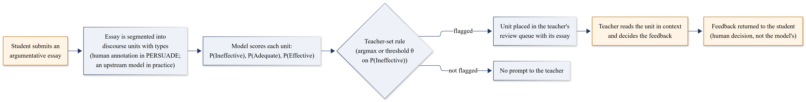

## Research questions

The project asks one main question and four sub-questions. Each sub-question has a pre-specified comparison and metric.

Main question. How well can a model predict the rater-assigned effectiveness of a discourse unit, on unseen essays from the same population, compared with simple and classical baselines, when every class matters?

- RQ1 (model families). On the same units and metrics, does a fine-tuned transformer (DeBERTa-v3-base) outperform a majority baseline and classical models (Logistic Regression, Random Forest) on Macro-F1 and on each class, especially Ineffective?
- RQ2 (controlled context check). Holding model, data split and training budget fixed, what does adding the neighbouring units (Level 1) add to the unit alone (Level 0), on the same units, per class and per discourse type? Do wider inputs (paragraph, source passage, whole essay) help further?
- RQ3 (prompt transfer). How much performance is lost when the prompt was never seen in training (leave-one-prompt-out), compared with an in-domain model scored on the same units?
- RQ4 (errors). Are errors associated with essay length, and if so, is that association explained by writer proficiency (holistic score) and class mix before any explanation in terms of missing context is offered? What do individual high-confidence failures show?

## Scope and contributions

The project does not propose a new architecture. DeBERTa on single units is the common starting point of the Kaggle Feedback Prize competition on this data (Crossley et al., 2024), so we treat it as a baseline, not as a contribution. Our contribution is a careful, reproducible evaluation:

1. a fair comparison of a majority baseline, an interpretable Logistic Regression, a Random Forest and DeBERTa on the same 29,102 validation units and the same 93,677 official test units, with per-class results and essay-level bootstrap intervals;
2. a controlled context ladder in which only the transformer input changes, analysed on the same units and per discourse type;
3. leave-one-prompt-out results kept separate from in-domain results, with an explicit map of which prompts each model covers;
4. an error analysis that first separates essay length from proficiency and class mix, then reads ten failure cases with recorded IDs;
5. a reproducibility package in which scripted checks trace every reported number back to the raw data and the saved per-unit predictions.

## Structure of the report

Chapter 2 reviews related work. Chapter 3 describes the data, the checks we ran on it and the exploratory analysis. Chapter 4 presents the models and the context representations. Chapter 5 gives the experimental protocol, including how the test set was used. Chapter 6 reports results. Chapter 7 analyses errors. Chapter 8 discusses what the results do and do not answer, and Chapter 9 concludes. The appendices contain the run table, reproduction instructions, individual contributions, the AI-use disclosure and supplementary tables.

# Literature Review

This chapter reviews the work that shaped our design decisions. For each strand we state what it established and which choice in our project it supports. Table 2.1 at the end of the chapter maps sources to decisions.

## Argument structure and argument quality

Most annotation schemes for student argumentation descend from Toulmin's (1958) model, in which a claim is supported by data and warrants and may be qualified or rebutted. Stab and Gurevych (2014, 2017) operationalised a Toulmin-like scheme for persuasive essays (major claims, claims, premises and their relations) and showed that argument components and relations can be identified automatically with useful accuracy. Their corpus, however, is small, written by adult learners, and does not rate the quality of each component.

Argument quality is a harder and more subjective notion than argument structure. Wachsmuth et al. (2017) organised quality into logical (cogency), rhetorical (effectiveness) and dialectical (reasonableness) dimensions and showed that annotators agree only moderately on many of them. Two recent position papers sharpen this point. Wachsmuth et al. (2024) argue that the diversity of quality notions and the subjectivity of their perception are the main obstacles to progress, and that context and background knowledge are needed for reliable assessment. Romberg et al. (2025) review argument-quality datasets and argue that, because several valid assessments can coexist, aggregated labels hide genuine disagreement and models should be evaluated with this in mind. For our project this means that the effectiveness label is a measurement with limited reliability, not ground truth, and that model–rater agreement must not be read as if it were rater–rater agreement (Section 8.3).

Two further strands treat quality as dependent on information outside the argument. Deshpande et al. (2024) contextualise each argument with generated knowledge (feedback, hidden assumptions, a counter-argument) and report gains in-domain and zero-shot. Liu et al. (2024) assess whether premises are sufficient for a conclusion through a causal, counterfactual formulation. Both support the hypothesis we test in RQ2: a unit's quality may not be readable from the unit alone.

## PERSUADE and the Feedback Prize

The PERSUADE 1.0 corpus (Crossley et al., 2022) annotated more than 25,000 essays by U.S. students in grades 6–12 for seven discourse elements, closely following the Toulmin tradition but adding Lead and Concluding Statement. PERSUADE 2.0 (Crossley et al., 2024) adds a holistic score (1–6) for every essay and an effectiveness rating (Effective, Adequate, Ineffective) for every discourse element. Ratings were made by trained raters in a double-blind process, with a third rater adjudicating disagreements. Two facts from that paper are central to our work.

1. Reliability. On 159,228 segments where two raters' segmentations overlapped by at least 50%, exact agreement was 0.718 but Cohen's κ was only 0.316 overall and between 0.165 (Claim) and 0.432 (Evidence) by element (Crossley et al., 2024, Section 2.1 and Table 1). The holistic scores were far more reliable (weighted κ = 0.745).
2. The Kaggle competition. About 80% of the corpus was released for the Feedback Prize "Predicting Effective Arguments" competition; more than 1,500 teams took part. The winning models were least accurate on Ineffective elements, which were usually predicted as Adequate (Crossley et al., 2024, Section 3 and Figure 1).

Baffour et al. (2023) analysed the winning Feedback Prize models and found minimal demographic bias for discourse-element detection but moderate bias for effectiveness prediction, with differences by race/ethnicity, economic status and English-language-learner status. This motivates our pre-defined subgroup description in Section 6.6, and our decision never to use demographic attributes as inputs or as decision thresholds.

## Context, prompt and argument type in effectiveness prediction

The closest work to ours is Ding, Bexte and Horbach (2023), who used the Kaggle subset of PERSUADE (4,192 essays, 15 prompts). With gold spans as input, they added three kinds of information to a Logistic Regression on TF-IDF n-grams and to a fine-tuned BERT: the argument type, the prompt, and the whole essay as context. Each piece of information helped individually. For BERT, quadratic weighted kappa rose from 0.42 for the argument alone to 0.46 with the prompt and 0.47 with the whole essay; for Logistic Regression it rose from 0.41 to 0.50 with all three (Ding et al., 2023, Table 3). Their data were split by random sampling, so every prompt appears in training and evaluation, and they reported accuracy and QWK averaged over folds rather than per-class results. They also showed that a multi-task model that predicts span, type and quality jointly outperforms a pipeline that segments first.

Schaller et al. (2025) evaluated argument-mining models on artificially fragmented essays from PERSUADE and the German DARIUS corpus. Token-level sequence taggers that rely on whole-essay context degraded sharply when context was limited or misleading, while sentence-level classifiers were more stable. Their result is a caution for our context ladder: more context can help, but a model that depends on it becomes sensitive to how that context is presented.

Favero et al. (2025) fine-tuned and prompted small open-source large language models on the Feedback Prize effectiveness data. Fine-tuned models outperformed baselines on segmentation and type classification, while few-shot prompting for quality assessment only matched the baselines. The course rules exclude LLM prompting as a model family; we cite this work to position our transformer baseline, not to compare against it.

Stahl et al. (2024) released a German school-student essay corpus annotated for both argumentative structure and quality and showed that structure and quality interact. This supports treating discourse type as an input feature.

## Models used in this project

DeBERTa (He et al., 2021) improves BERT (Devlin et al., 2019) with disentangled attention over content and relative position. DeBERTa-v3 (He et al., 2023) adds ELECTRA-style replaced-token-detection pre-training and was the standard backbone among top Feedback Prize solutions. We use DeBERTa-v3-base for all transformer runs. Random Forests (Breiman, 2001) average many decision trees trained on bootstrap samples with random feature subsets; they handle sparse TF-IDF features, mixed feature types and non-linear interactions without scaling, but their individual predictions are hard to explain. Logistic Regression on TF-IDF features is a linear model whose weights can be read directly; it serves as our interpretable reference.

## Evaluation methodology

Because units from the same essay share a writer, a prompt and a writing occasion, they are not independent. Splitting, resampling and confidence intervals must therefore operate at the essay level, and preprocessing (TF-IDF vocabularies, scalers) must be fitted on training data only; the scikit-learn documentation on common pitfalls and on grouped cross-validation states both rules (Pedregosa et al., 2011). We use the non-parametric bootstrap (Efron & Tibshirani, 1993) with essays as the resampling unit and report a confidence interval for the paired difference between two systems, which addresses "A versus B" directly. Cohen's κ (Cohen, 1960) and its quadratic-weighted variant measure agreement corrected for chance; for an ordinal three-class label, QWK penalises Ineffective↔Effective confusions more than adjacent ones. Calibration of neural-network probabilities is discussed by Guo et al. (2017); it matters here because any threshold on P(Ineffective) assumes that probabilities are meaningful.

## Research gap

Table 2.1 summarises how the literature shaped our design. Three gaps motivated the project. First, published results on PERSUADE effectiveness rarely report per-class performance, even though the minority Ineffective class is the one a teacher most needs. Second, the claim that context helps has been tested by adding the whole essay at once (Ding et al., 2023); a controlled ladder that changes one input at a time, on the same units and with essay-level uncertainty, was not available. Third, prompt transfer and the confound between essay length, proficiency and label mix have not, to our knowledge, been examined together with context effects on this corpus.

Table 2.1. How the sources read supported specific design decisions.

| Source | Finding used | Decision in this project |
|---|---|---|
| Crossley et al. (2024) | Effectiveness κ = 0.316; Ineffective hardest for Kaggle models | Macro-F1 and per-class F1 as primary metrics; label reliability stated as a ceiling on interpretation |
| Crossley et al. (2022); Stab & Gurevych (2017) | Discourse elements follow a Toulmin-like scheme; segmentation is a separate, error-prone step | Gold segmentation and type used as given; end-to-end use left out of scope |
| Ding et al. (2023) | Type, prompt and whole-essay context each raise QWK | Discourse type always in the input; Prompt-Aware and whole-essay (L3) inputs tested |
| Schaller et al. (2025) | Context-dependent models degrade when context is limited | Context added one step at a time; Level 0 kept as a control |
| Baffour et al. (2023) | Moderate demographic bias in effectiveness models | Demographics never used as input; ELL described as a pre-defined subgroup |
| Wachsmuth et al. (2017, 2024); Romberg et al. (2025) | Argument quality is subjective and context-dependent | Model–rater κ not compared with rater–rater κ; conclusions limited to "agreement with adjudicated labels" |
| Deshpande et al. (2024); Liu et al. (2024) | Quality may depend on knowledge outside the argument | Source passage (L2) and whole essay (L3) tested as hypotheses, not assumed |
| He et al. (2023) | DeBERTa-v3 is a strong encoder for this data | DeBERTa-v3-base as the transformer family |
| Pedregosa et al. (2011); Efron & Tibshirani (1993) | Fit preprocessing on training data; resample at the group level | Essay-grouped split; essay-level paired bootstrap |

# Data

## Source, licence and permitted use

We use the PERSUADE 2.0 corpus (Crossley et al., 2024), distributed through the authors' repository (github.com/scrosseye/persuade_corpus_2.0) as two CSV files: a training file and a password-protected test file. The corpus is released under the Creative Commons BY-NC-SA 4.0 licence, which permits non-commercial academic use with attribution and share-alike. Our use (a course project, no redistribution of the data, no commercial purpose) is within these terms. Because the CSV files are large and licensed, they are not committed to the project repository; `.gitignore` excludes them, and Appendix B gives the download instructions and the SHA-256 hashes that identify the exact files used.

The corpus also contains demographic fields (gender, race/ethnicity, ELL status, economic disadvantage, disability status). They are used only to describe performance for one pre-defined subgroup (ELL status, Section 6.6); they are never model inputs. Source texts of the source-based prompts are copyrighted articles and are not part of the CSV (the `source_text` column holds only their titles); the texts we used for Level 2 are kept locally and excluded from the repository.

## Unit of observation and labels

The unit of observation is one annotated discourse unit: a contiguous span of a student essay that a trained annotator labelled with one of seven discourse types. Each unit carries one effectiveness label. Table 3.1 gives the official definitions, condensed from the rubric shipped with the corpus (`argumentation_effectiveness_rubric.pdf`).

Table 3.1. Discourse types and effectiveness labels (condensed from the PERSUADE effectiveness rubric).

| Discourse type | What it does | Effective | Ineffective |
|---|---|---|---|
| Lead | Opens the essay | Grabs attention and strongly points toward the position | May not grab attention and may not point to the position |
| Position | States the writer's stance | Clear stance closely related to the topic | Not relevant to the topic and/or no clear stance |
| Claim | Supports the position | Closely relevant to the position, with specific points; valid | Irrelevant to the position; weak or not acceptable |
| Counterclaim | States an opposing view | Reasonable, relevant, a valid objection | Neither reasonable nor relevant |
| Rebuttal | Answers the counterclaim | Directly answers and refutes the counterclaim | Does not answer the counterclaim (Adequate: answers indirectly or weakly) |
| Evidence | Supports a claim | Closely relevant; concrete facts, examples or studies; sound reasons | Irrelevant to the claim; few valid examples; unacceptable assumptions |
| Concluding Statement | Closes the essay | Restates the claims in a new way and strengthens the position | Does not restate or support the position |

Adequate lies between the two: in the corpus paper's words, the writer "sufficiently fulfilled the function of the element" (Crossley et al., 2024, Section 2.1). Two properties of these definitions matter for modelling. First, the label is relational: a Claim is judged against the Position, a Rebuttal against the Counterclaim, Evidence against the Claim it supports, and a Position against the prompt. Information needed to judge a unit can therefore lie outside the unit, which is the motivation for the context experiments (RQ2). Second, the label is a rater judgement with limited reliability (κ = 0.316 between raters before adjudication; Section 2.2), so the gold label is a proxy for effectiveness, not ground truth.

We map the labels to integers once, explicitly: Ineffective = 0, Adequate = 1, Effective = 2. This fixed mapping matters because scikit-learn orders string classes alphabetically (Adequate, Effective, Ineffective); code that assumes a different column order silently swaps the classes.

## Independent groups

Units are nested in essays, essays in prompts, and each essay was written by one student. Three consequences follow. Units of the same essay must never be split between training and evaluation; confidence intervals must resample essays, not units; and claims about new prompts require holding out whole prompts. The corpus provides one essay per student in our data, so essay and student groups coincide.

## From raw records to annotated units

Figure 3.1 shows the filtering and splitting pipeline. The same rule is applied to both files: keep records that have an effectiveness label and non-empty text, strip whitespace, and number the remaining units in file order. The resulting position, `row_idx`, is the key that every prediction file uses (Section 3.5).

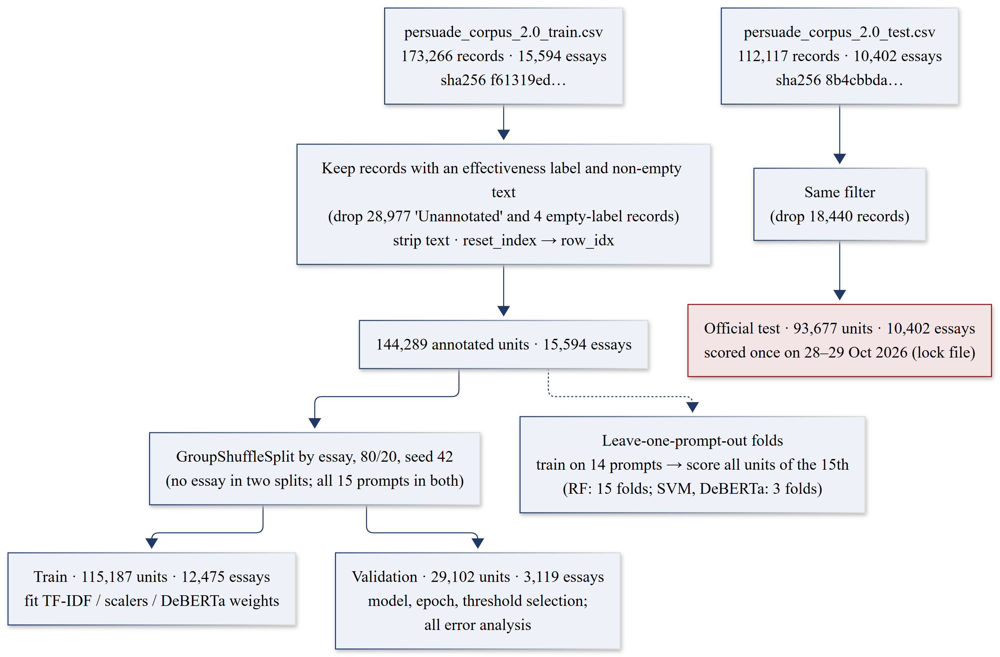

Table 3.2. Record filtering (script `final_report/scripts/01_data_checks_eda.py`, table D2).

| File | Raw records | Records without an effectiveness label | Of which typed "Unannotated" | Annotated units | Essays |
|---|---:|---:|---:|---:|---:|
| Training file | 173,266 | 28,977 | 28,973 | 144,289 | 15,594 |
| Test file | 112,117 | 18,440 | 18,437 | 93,677 | 10,402 |

The records without a label are almost entirely text that annotators did not assign to any discourse element ("Unannotated"); seven records of other types have an empty label and are dropped as well.

The 144,289 training-file units were split with `GroupShuffleSplit` (80/20, grouped by essay, seed 42). Table 3.3 gives the result. All 15 prompts occur in both training and validation, so this split measures generalisation to new essays on known prompts; generalisation to new prompts is measured separately (Section 5.3).

Table 3.3. Units, essays and label distribution by split.

| Split | Units | Essays | Ineffective (%) | Adequate (%) | Effective (%) | Role |
|---|---:|---:|---:|---:|---:|---|
| Train | 115,187 | 12,475 | 4.46 | 78.44 | 17.11 | Fit all models and preprocessing |
| Validation | 29,102 | 3,119 | 4.56 | 78.68 | 16.76 | Model, epoch and threshold selection; all error analysis |
| Official test | 93,677 | 10,402 | 4.51 | 80.45 | 15.04 | One scoring pass with a locked configuration |
| All annotated | 237,966 | 25,996 | 4.49 | 79.26 | 16.25 | — |

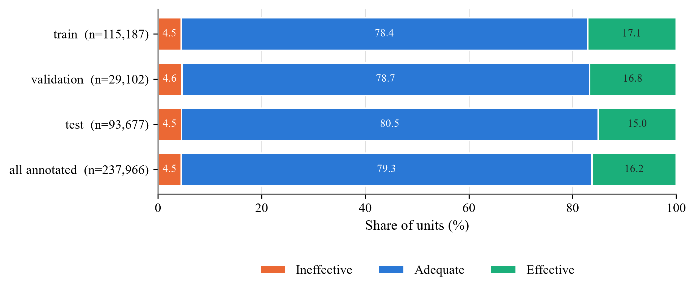

## Data verification

Before any result is interpreted, the identifier joins and the label loading must be shown to be correct on raw examples. The script `final_report/scripts/01_data_checks_eda.py` re-reads both raw CSV files and runs the checks in Table 3.4; its full log is in `final_report/evidence/data_checks_log.txt`. All checks passed.

Table 3.4. Data verification checks (all passed on 15 November 2026).

| ID | Check | Result |
|---|---|---|
| C1 | SHA-256 of the training and test CSV equal the hashes logged by the training run and by the test lock file | Equal (f61319ed…, 8b4cbbda…) |
| C2 | Filtering reproduces 173,266 → 144,289 and 112,117 → 93,677 | Reproduced |
| C3 | Label vocabulary is exactly {Adequate, Effective, Ineffective}; every unit gets an integer label; type vocabulary is the seven discourse types | Confirmed in both files |
| C4 | Identifier integrity | `discourse_id` has only 728 distinct values for 144,289 units; `essay_id_comp` is intact (15,594 + 10,402 essays) |
| C5 | Each of 17 saved prediction files agrees with the raw data, row by row, on essay, discourse type and gold label | 0 mismatches in about 699,000 rows |
| C6 | Split integrity: no essay in two splits; no training or validation essay in the test; all prompts in both training and validation; each LOPO fold scores every unit of exactly one prompt | Confirmed |
| C7 | Six raw records traced from the CSV to the prediction file (Table 3.5) | All agree at every step |

The identifier check (C4) records the most important data risk we found. The CSV files we worked from had been opened and saved in a spreadsheet program at some point, which converted the numeric `discourse_id` to scientific notation (for example `1.62144E+12`). As a result, one stored `discourse_id` value can be shared by up to 932 units from 93 different essays. Any join on `discourse_id` silently attaches the wrong essay's attributes to a unit. The numeric `essay_id` is also partly corrupted (one stored value covers two essays), while `essay_id_comp`, a hexadecimal string, is intact. Every analysis in this report therefore joins units by `row_idx` or by `essay_id_comp`, and each join is checked against discourse type and gold label before use.

Table 3.5 traces six records end to end: five drawn at random from the validation split (seed 2026) and the case used throughout the report (row_idx 108613). For each, the label string in the raw file, the integer loaded by our code, and the gold label stored in the prediction file agree.

Table 3.5. Six raw records traced from the CSV to the prediction file (table D7). "Raw record" is the 0-based record number in the training CSV; the stored discourse_id shows the spreadsheet corruption. The label column follows one unit from the raw string to the integer loaded by our code and to the gold label stored in the prediction file.

| row_idx | Raw record | essay_id_comp | Stored discourse_id | Type | Label: raw → loaded → file | L1 prediction |
|---:|---:|---|---|---|---|---|
| 93085 | 111932 | A1B2F28757E3 | 1.61513E+12 | Claim | Adequate → 1 → 1 | Ineffective |
| 53101 | 64465 | 6D1D5D542E08 | 1.61956E+12 | Claim | Adequate → 1 → 1 | Adequate |
| 25444 | 31612 | 7D378AEFD0C3 | 1.62005E+12 | Claim | Adequate → 1 → 1 | Adequate |
| 123137 | 146304 | 8AE119913109 | 1.62197E+12 | Concluding Statement | Effective → 2 → 2 | Effective |
| 3642 | 4088 | E0ACC902891D | 1.62252E+12 | Claim | Adequate → 1 → 1 | Adequate |
| 108613 | 130257 | FE3141FA4163 | 1.62015E+12 | Claim | Ineffective → 0 → 0 | Adequate |

Two further observations came out of the checks. On a random sample of 3,000 units, the unit text was always found inside the essay's `full_text`, but it started exactly at the stored `discourse_start` offset only 27% of the time. Offsets are therefore approximate; our context inputs use the order of units within an essay, not character offsets. Second, one prompt name is stored with surrounding quotation marks in the raw file ("A Cowboy Who Rode the Waves") but without them in our prediction files; the check normalises this before comparing.

## Missing values and duplicates

Among the 237,966 annotated units, holistic score, essay word count, prompt, task type and `discourse_start` are never missing. Grade level is missing for 4.67% of units and ELL status is missing or blank for 5.12%; neither is a model input. Fifty-one units repeat exactly within the same essay. Across essays, 423 distinct unit texts occur in two or more essays (1,338 units, mostly short formulaic sentences such as "summer projects should be student-designed", which appears 54 times); 85 of these texts carry different labels in different essays, a direct illustration that the label depends on the surrounding essay. 415 such short texts also occur in the test file. We kept all of them: they are genuine, independently written units, and removing them would bias the data towards longer units.

## Exploratory data analysis

### Label imbalance and discourse types

Effectiveness is heavily imbalanced: Ineffective units are 4.5% of the data and Adequate 79.3%. A model that always predicts Adequate reaches 78.7% accuracy on validation and 80.5% on test while never finding a weak unit. Accuracy is therefore not a useful headline metric for this task (Section 5.4).

The Ineffective rate varies by discourse type (Figure 3.3). Evidence has the highest rate (6.9%) and Claim the lowest (2.9%); Claim and Evidence together make up two thirds of all units. Discourse type alone is only weakly associated with the label (Cramér's V = 0.075; Table 3.6).

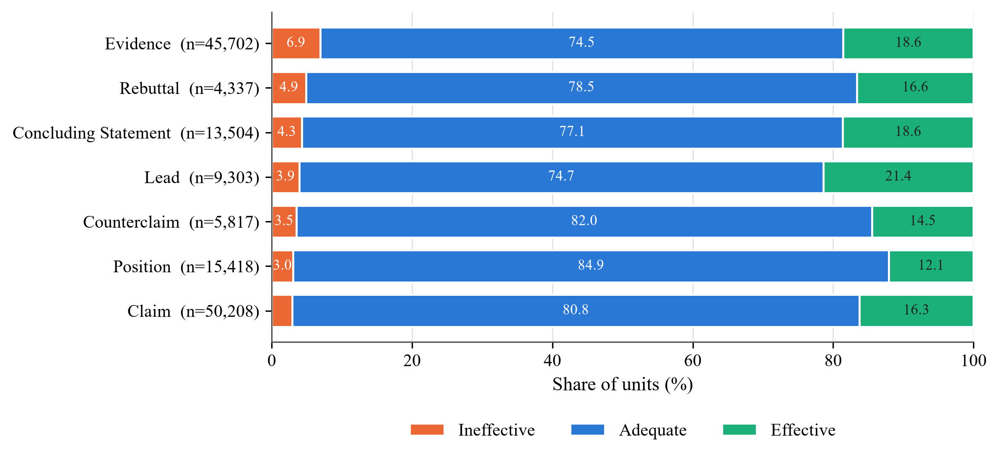

### Prompts and task type

The label mix differs strongly between prompts (Figure 3.4). The four prompts with the most Ineffective units are all source-based: "Does the electoral college work?" (11.5%), "Exploring Venus" (11.4%), "The Face on Mars" (9.9%) and "Facial action coding system" (9.2%). Several independent prompts have fewer than 1% Ineffective units but 20–30% Effective units. A model can therefore learn prompt-specific priors, which is one reason to test prompt transfer (RQ3).

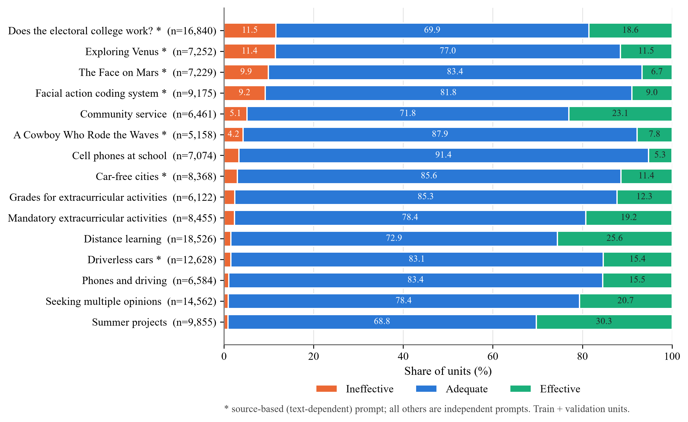

### Unit length

Effective units are much longer than the others (median 52 words against 25 for Adequate and 29 for Ineffective; Figure 3.5). Ineffective units are not simply short: their median is slightly above that of Adequate units, and the interquartile ranges overlap. Length is a useful but weak cue, and a model that relied on it would mistake long but off-topic units (case 2 in Section 7.3) for Effective ones.

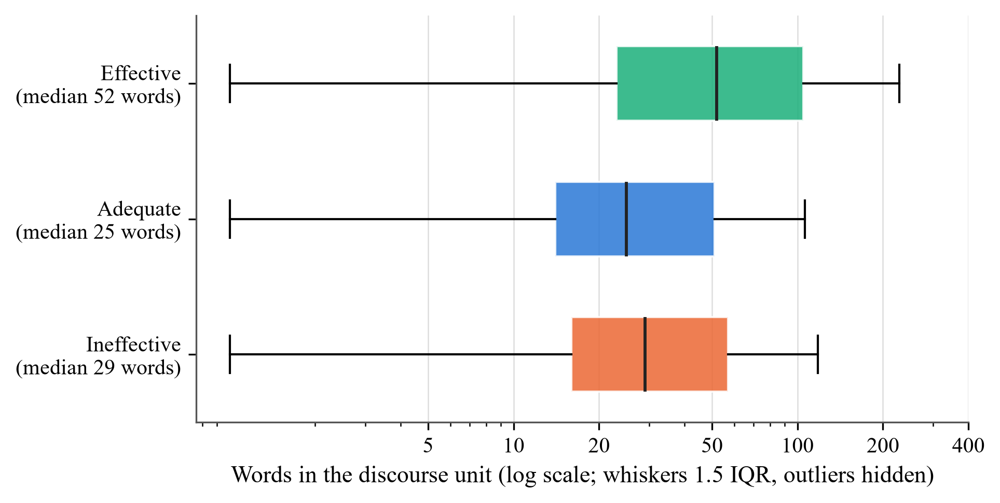

### Essay length, holistic score and class mix

Before any error is attributed to lost context, we check whether essay length is associated with the holistic score and with the class mix. It is, strongly. At the essay level, length and holistic score have a Spearman correlation of 0.76 (n = 25,996 essays; Figure 3.6): the median essay with score 2 has 229 words, the median essay with score 6 has 824.

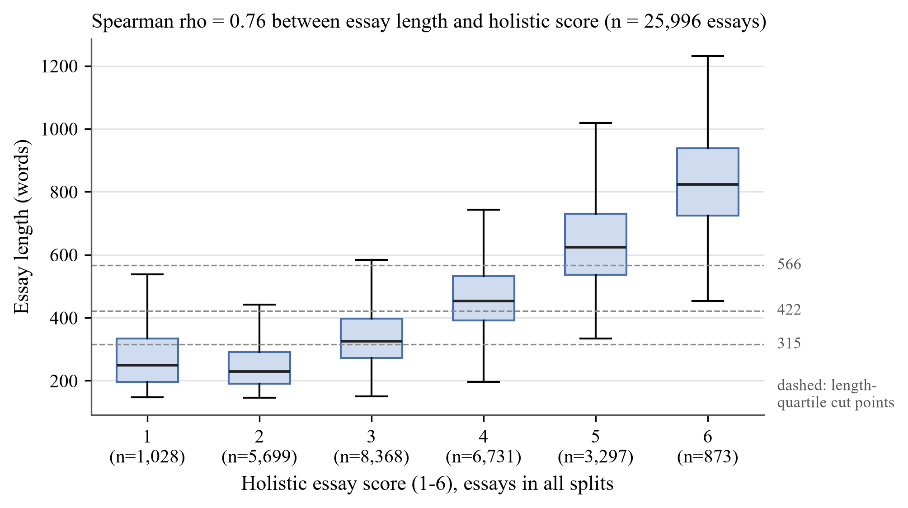

The class mix moves with both variables (Figure 3.7). In essays with holistic score 1, 59.8% of units are Ineffective; in essays with score 6, 0.2% are Ineffective and 53.8% Effective. Across length quartiles, the Ineffective share falls from 8.7% (Q1, ≤315 words) to 1.4% (Q4, ≥567 words) while the Effective share rises from 5.4% to 34.5%, and the mean holistic score rises from 2.39 to 4.66. Table 3.6 compares the strength of these associations: the holistic score is the variable most strongly associated with the unit label (Cramér's V = 0.386), followed by essay length (0.221) and prompt (0.188).

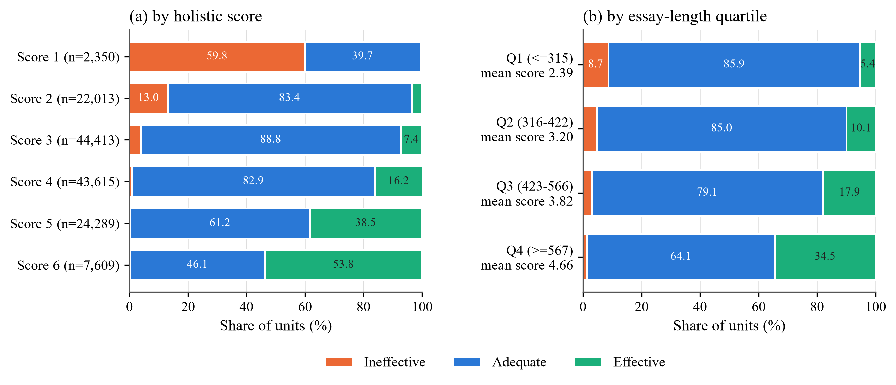

Table 3.6. Association of each variable with the unit label (train + validation units; χ² test of independence, all p < 10⁻¹⁰⁰; table E6d).

| Variable | χ² | Cramér's V |
|---|---:|---:|
| Holistic score (1–6) | 43,093 | 0.386 |
| Essay-length quartile | 14,152 | 0.221 |
| Prompt (15) | 10,218 | 0.188 |
| Task type (independent / source-based) | 3,786 | 0.162 |
| Discourse type (7) | 1,643 | 0.075 |

Within the same holistic score the class mix changes much less, but not uniformly (Figure 3.8). For scores 4 and 5, the Effective share rises only slightly with length (score 4: 11.5% → 18.8%). For score 2, the Ineffective share rises with length (10.6% in Q1 to 25.3% in Q3), so long essays with a low score contain more weak units than short ones. This matters for Chapter 7: a rising error rate across length quartiles could reflect a changing class mix rather than a harder task, and we must compare errors within the same score and class before blaming lost context.

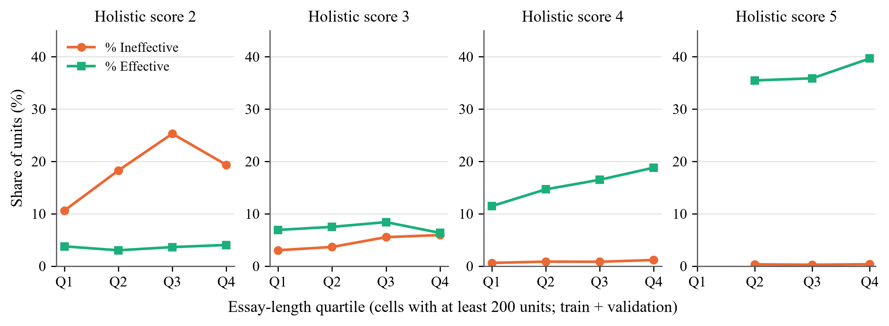

### Essays, units per essay and subgroups

Essays contain on average 9.2 annotated units (median 9, range 1–29). 20.8% of essays contain at least one Ineffective unit, but only 3.4% contain both an Ineffective and an Effective unit: weak and strong units rarely co-occur in the same essay, which is consistent with the dependence of unit labels on writer proficiency. ELL status is recorded as "Yes" for 1,062 training, 268 validation and 914 test essays (about 9%); ELL essays contain far more Ineffective units (12.2% on validation) and fewer Effective units (4.8%) than other essays.

## One unit traced through the pipeline

We use one validation unit throughout the report to show the full path from data to prediction (Table 3.7). It is one of the ten failure cases studied in Section 7.3 (case 8).

Table 3.7. Case 8 traced from raw record to prediction.

| Step | Value |
|---|---|
| Raw record / row_idx | Record 130257 of the training CSV / row_idx 108613; validation split |
| Essay | essay_id_comp FE3141FA4163; prompt "Cell phones at school" (independent); holistic score 2; 169 words |
| Unit | Claim: "Some kids will ask there parents to transfer school" (9 words) |
| Gold label | Ineffective (id 0) |
| Level 0 input | `Claim [SEP] Some kids will ask there parents to transfer school` |
| Level 1 input | `Claim [SEP] Previous: They will hide them from the teachers … You will just make all the kids mad. [SEP] Target: Some kids will ask there parents to transfer school [SEP] Next: If you chose policy one you will make the student happy.` (95 tokens, no truncation) |
| Prompt-Aware input | `Prompt: Cell phones at school [SEP]` + Level 1 input |
| Majority baseline | Adequate |
| Logistic Regression (FS-B) | P = 0.052 / 0.916 / 0.032 → Adequate (Section 4.2 traces the weights) |
| Random Forest (FS-B) | P = 0.286 / 0.485 / 0.229 → Adequate |
| DeBERTa L0 / L1 / PA | P(Ineffective) = 0.017 / 0.058 / 0.217 → Adequate in all three |
| Outcome | All models miss this unit; context raises P(Ineffective) but not above the other classes |

The unit is a bare prediction with no reason. Its weakness is visible to a reader who knows that a Claim should support the position with a specific point; none of the models flags it under the argmax rule. Section 6.5 shows what a lower threshold on P(Ineffective) would change for this unit and for the whole validation set.

# Methods

Figure 4.1 gives an overview of the modelling pipeline. Two model families from the course are compared against a trivial baseline: classical models on engineered sparse features (Logistic Regression and Random Forest) and a fine-tuned transformer encoder (DeBERTa-v3-base). Changing hyperparameters within one family is not counted as a second family.

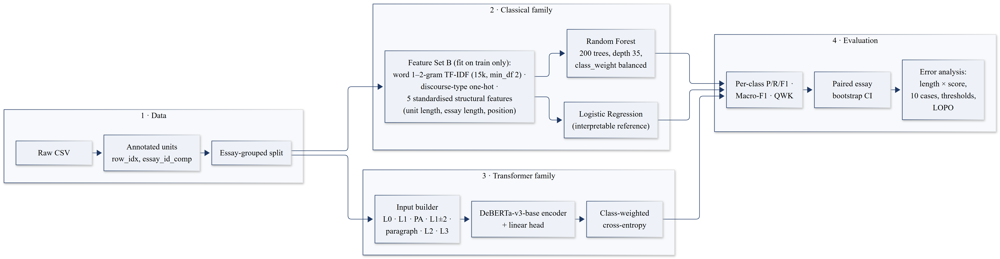

## Baseline

The majority-class baseline predicts Adequate for every unit. It needs no training and sets the floor that any useful model must beat on Macro-F1 (0.294 on validation, 0.297 on test). Its accuracy (78.7% and 80.5%) shows why accuracy cannot be the headline metric.

## Classical family: features, Logistic Regression and Random Forest

### Feature Set B

Both classical models use Feature Set B (FS-B), defined in `01_Data_Pipeline_Classical_Baseline.py`:

1. word unigram and bigram TF-IDF of the unit text (at most 15,000 features, minimum document frequency 2, sublinear term frequency);
2. a one-hot encoding of the discourse type (7 columns);
3. five structural features, standardised: unit length in characters, unit length in words, essay length in words, relative start position of the unit in the essay, and the ratio of unit length to essay length.

The TF-IDF vocabulary, the one-hot encoder and the scaler are fitted on the 115,187 training units only and then applied to validation and test units. All FS-B features are available at prediction time. Note that essay length is itself a feature; given the strong association between essay length and proficiency (Section 3.7.4), the classical models can exploit proficiency indirectly.

### Logistic Regression (interpretable reference)

Multinomial Logistic Regression models the class probabilities as a softmax of linear scores, P(y = k | x) ∝ exp(w_k · x + b_k), and is fitted by minimising the cross-entropy loss with L2 regularisation (C = 1). Its assumptions are that the log-odds between classes are linear in the features and that units are conditionally independent given the features. We use class weights inversely proportional to class frequency so that errors on the rare Ineffective class cost more. The model is interpretable: the contribution of each feature to the score of each class is its weight times its value.

Table 4.1 shows the trace of case 8 through a Logistic Regression refitted for this report on the training split (scikit-learn, argmax decision; validation Macro-F1 0.489, matching the original classical benchmark, 0.488). The words "kids will", "ask", "parents" and "kids" push the unit towards Adequate rather than Ineffective, the short unit and the Claim type push slightly the same way, and the total log-odds of Ineffective versus Adequate is −2.87, giving P(Ineffective) = 0.052. The weights are lexical: nothing in the model can represent that the claim lacks a reason.

Table 4.1. Logistic Regression trace for case 8: the largest contributions to logit(Ineffective) − logit(Adequate) (table L3).

| Feature | Value (TF-IDF or standardised) | Contribution |
|---|---:|---:|
| "kids will" | 0.378 | −0.785 |
| "ask" | 0.216 | −0.567 |
| "parents" | 0.249 | −0.484 |
| "kids" | 0.216 | −0.471 |
| "there parents" | 0.410 | −0.341 |
| "school" | 0.147 | −0.292 |
| "some kids" | 0.331 | +0.245 |
| unit/essay length ratio | −0.511 | −0.239 |
| type = Claim | 1 | −0.232 |
| unit characters | −0.787 | −0.222 |
| Intercept difference | — | +0.798 |
| Total log-odds (all features) | — | −2.870 |

The largest positive weights for Ineffective (relative to the average class) include "witch", "plant", "aliens", "venus" and "story" (table L2). These are topic words of particular prompts with many Ineffective units ("The Face on Mars", "Exploring Venus"), which confirms that a lexical model partly learns prompt priors rather than argument quality. This is one motivation for the prompt-transfer experiment.

### Random Forest

The Random Forest (Breiman, 2001) averages 200 decision trees (maximum depth 35, minimum 5 samples per split, `class_weight = "balanced"`, seed 42), each trained on a bootstrap sample with a random subset of features at each split. It makes no linearity assumption and captures interactions such as "short unit and Position type", at the cost of interpretability. It was the strongest classical model on validation (Macro-F1 0.523, against 0.509 for Logistic Regression with thresholds tuned on validation and 0.487 for LightGBM) and is the classical system in the test protocol. Figure 4.2 shows a what-if trace for case 8: correcting the spelling, adding a reason or lengthening the essay lowers P(Ineffective); re-typing the unit as Evidence raises it; no single change flips the prediction from Adequate.

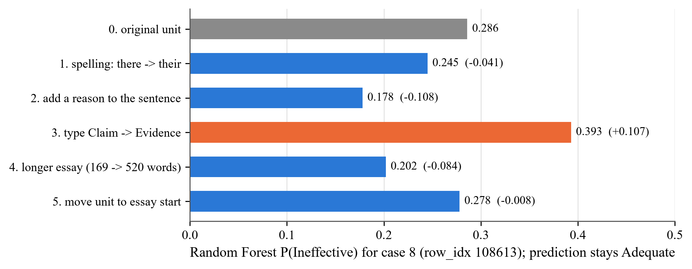

### Linear SVM (supplementary)

A linear support vector machine on word TF-IDF features was run as a supplementary classical system on the official test and on the three LOPO folds. It belongs to the same linear family as Logistic Regression and is reported for completeness only.

## Transformer family: DeBERTa-v3-base

### Architecture and loss

DeBERTa-v3-base (He et al., 2023) is a 12-layer transformer encoder with disentangled attention over content and relative position, pre-trained with replaced-token detection. We add a linear classification head on the first-token representation and fine-tune all weights. The model maps an input text to three logits; the softmax of the logits gives the class probabilities. Training minimises class-weighted cross-entropy,

$$\mathcal{L} = -\frac{1}{N}\sum_{i=1}^{N} w_{y_i}\,\log p_\theta(y_i \mid x_i), \qquad w_k = \frac{N}{3\,N_k},$$

where N_k is the number of training units of class k. On the training split this gives w = (7.48, 0.43, 1.95) for Ineffective, Adequate and Effective. The weights trade accuracy on the majority class for recall on the minority classes; they also shift the predicted probabilities away from the true base rates, which is why probabilities are not used as calibrated risks without checking (Section 6.7).

### Why this model suits the data

The label depends on meaning (relevance to the position, soundness of reasons) rather than on surface words, and the input is natural text of 10–300 words. A pre-trained encoder brings knowledge of syntax and semantics that a bag-of-n-grams model lacks, and it can read the unit together with its context in a single input. Its assumptions are that the pre-trained representation transfers to student writing and that units are exchangeable given their input text. Its costs are a GPU requirement, sensitivity to the training run (Section 6.7), and opaque predictions.

### Context representations

The context ladder changes only the text that the encoder reads. Figure 4.3 shows the variants and Table 4.2 defines them. Level 0 and Level 1 form the planned comparison; the other inputs are supplementary.

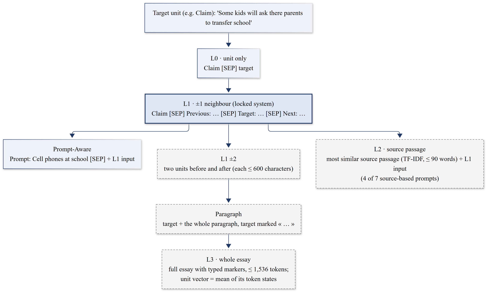

Table 4.2. Inputs of the context ladder. All variants use the same split, model, optimiser and epoch selection unless stated.

| Level | Input to the encoder | What it adds over the previous level | Status |
|---|---|---|---|
| L0 | `type [SEP] unit` | — (unit alone) | Protocol, scored on test |
| L1 | `type [SEP] Previous: u(j−1) [SEP] Target: u(j) [SEP] Next: u(j+1)`; `[NONE]` at essay boundaries | The immediately preceding and following units of the same essay | Protocol, locked, scored on test |
| Prompt-Aware (PA) | `Prompt: <prompt name> [SEP]` + L1 input | The task the essay responds to | Exploratory, scored on test |
| L1 ±2 | Two units on each side, each capped at 600 characters | A wider local window | Validation only |
| Paragraph | Target, then the whole paragraph containing it with the target marked « … » | The paragraph as a unit of thought | Validation only |
| L2 | Most similar passage of the source text (TF-IDF retrieval, ≤ 90 words) + L1 input | The reading the student was asked to use | Validation only; 4 of 7 source-based prompts (full text for 2, a summary for 2); other prompts keep the L1 input |
| L3 | The whole essay with typed markers around every unit, up to 1,536 tokens; each unit represented by the mean of its token states; one forward pass per essay | The whole argument (e.g. whether a counterclaim is ever answered) | Validation only; 3-epoch and 7-epoch runs |

What Level 1 adds to Level 0. Level 1 gives the model the two units that physically surround the target in the essay. For a Claim, the previous unit is often the Position or another Claim and the next is often its Evidence; for a Counterclaim, the next unit is often the Rebuttal. Level 1 can therefore show whether a claim is followed by support or a counterclaim by an answer when that support or answer is adjacent. It cannot show anything that lies further away, such as a rebuttal three paragraphs later or the content of the source article. The comparison of L0 and L1 is made on exactly the same units, splits and training budget (Section 6.2).

### Training configuration

Table 4.3 lists the configuration of the runs that were scored on the official test. The supplementary runs used the same configuration on an L4 GPU, except where Table 4.2 states otherwise.

Table 4.3. DeBERTa training configuration (`Week11_Person3_DeBERTa_OfficialTest/outputs/week11_person3/run_metadata.json`).

| Setting | Value |
|---|---|
| Backbone | microsoft/deberta-v3-base |
| Maximum input length | 512 tokens (L3: 1,536) |
| Batch | 8 per device × 4 gradient-accumulation steps = 32 |
| Optimiser and schedule | AdamW, learning rate 2 × 10⁻⁵, linear schedule with 10% warm-up |
| Epochs and selection | 3 epochs; checkpoint with the best validation Macro-F1 |
| Loss | Class-weighted cross-entropy, weights 7.48 / 0.43 / 1.95 |
| Seed | 42 |
| Precision and hardware | bf16 on one NVIDIA A100 40 GB (Google Colab); supplementary runs on L4 |
| Software | Python 3.13, PyTorch 2.11, transformers 4.57.6 (version 5.x did not train DeBERTa-v3 correctly) |

## Model selection

All model choices were made on the validation split: the feature set and classical model, the decision to drop a BERT + DeBERTa ensemble, the epoch of each DeBERTa run, and the choice of Level 1 as the locked system. Level 1 was locked because of its higher Ineffective F1 on validation (+0.019), not because its Macro-F1 was clearly higher: in the first training run, L1 − L0 was +0.002 with a confidence interval containing zero. The official test played no part in any choice (Section 5.5).

# Experimental Setup

## Splits and what each split is used for

Three disjoint sets of essays are used (Table 3.3). The training split (115,187 units, 12,475 essays) fits every model and every preprocessing step. The validation split (29,102 units, 3,119 essays) is used for all selection and for all error analysis. The official test (93,677 units, 10,402 essays) is a separate file released by the corpus authors; it was scored once with a locked configuration. The training/validation split is grouped by essay (`GroupShuffleSplit`, seed 42), so no essay contributes units to both sides. It is not grouped by prompt: all 15 prompts appear in both splits, as they do in the official test. The in-domain results therefore answer "how well does the model do on new essays written for known prompts".

## Information available at prediction time and where preprocessing is fitted

All model inputs are available once an essay has been submitted and segmented: the unit text, its discourse type, the other units and paragraphs of the same essay, the prompt name, and, for source-based prompts, the source text the students read. The holistic essay score is not used as an input because it is assigned by a rater after reading the whole essay; using it would leak a rater judgement into the prediction. The essay word count in FS-B is computed from the essay itself and is available. Demographic fields are not used.

Every fitted transformation is fitted on the training split only: the TF-IDF vocabulary and IDF weights, the one-hot encoder, the standard scaler, the class weights of the loss, and the neural network weights. In LOPO folds the same transformations are refitted on the 14 training prompts of each fold. The quartile cut points used to describe essay length (315, 422 and 566 words) were computed on validation units and then applied unchanged to the test; they are descriptive and do not enter any model.

## Leave-one-prompt-out folds

To measure transfer to unseen prompts, a LOPO fold trains on every annotated unit of 14 prompts and scores every unit of the remaining prompt. The Random Forest (FS-B) was run on all 15 folds. Because each DeBERTa fold costs about 40–45 GPU-minutes, DeBERTa L0 was run on three folds chosen from the Random Forest ranking: the hardest prompt ("A Cowboy Who Rode the Waves", rank 1 of 15), the median prompt ("Summer projects", rank 8) and the easiest prompt ("Distance learning", rank 15). The linear SVM was run on the same three folds. Each DeBERTa fold is trained for a fixed 3 epochs and the final model scores the held-out prompt once, so the held-out prompt plays no part in model or epoch selection.

LOPO results are kept separate from in-domain results throughout. A LOPO score on all units of a prompt and an in-domain score on the validation essays of that prompt describe different sets of units; the only direct comparison we report is on the same units, the validation essays of the held-out prompt, scored by the LOPO model and by the in-domain model (Section 6.4).

## Metrics

The primary metric is Macro-F1, the unweighted mean of the F1 scores of the three classes, because every class matters to the user and the classes are imbalanced. It is always reported together with per-class precision, recall and F1, so that a gain on the majority class cannot hide a loss on Ineffective. Accuracy, balanced accuracy (mean recall), Cohen's κ and quadratic weighted κ (QWK) are secondary. For an Ineffective flag used as a review queue, we also report the number of units flagged, newly caught and newly mis-flagged when the decision threshold changes.

Uncertainty is estimated with a paired, essay-level bootstrap: essays are resampled with replacement (2,000 resamples unless stated), both systems are scored on the same resample, and the 2.5th and 97.5th percentiles of the difference form a 95% confidence interval. Decisions are based on whether this two-sided interval excludes zero. This interval reflects sampling of essays only; it does not reflect variation between training runs, which we measure separately (Section 6.7).

## Use of the official test set

The official test file was used once, for the final comparison, under a protocol fixed beforehand (Figure 5.1 and Table 5.1). An early exploratory notebook had used half of the official test file as a development split for two linear baselines; none of those models or numbers is used anywhere in this report, and all selection reported here was made on the validation split.

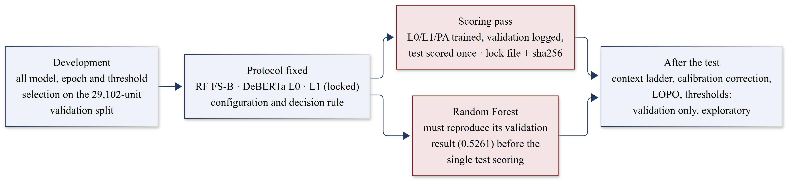

Table 5.1. Test protocol and its conditions.

| Element | Description |
|---|---|
| Systems scored | Protocol: Random Forest (FS-B), DeBERTa L0 and DeBERTa L1 (locked). Exploratory: Prompt-Aware. Supplementary: linear SVM |
| Fixed before scoring | Model, input format, hyperparameters, epoch-selection rule, argmax decision rule; L1 locked although L0 and L1 could not be distinguished on validation |
| DeBERTa scoring pass | L0, L1 and PA trained with the locked configuration, validation predictions logged, test scored once; the lock file `OFFICIAL_TEST_LOCK.json` records the test-file hash, model paths and configuration. Training, validation and test ran in one session, so validation results were logged but not reviewed by a person before the test pass |
| Random Forest scoring | The FS-B implementation was required to reproduce its validation result (0.5261, against 0.5230 originally) before the test was scored once |
| After the test pass | Context ladder, post-hoc class-offset correction, LOPO and threshold analyses: validation only, labelled exploratory, never scored on the test |

## Experiment matrix

Table 5.2 lists the experiments behind the main results. Each row records the question, the single change made, the configuration, split and seed, the metric, and the decision taken after inspecting it. Appendix A gives the complete run table with output locations.

Table 5.2. Main experiment matrix.

| # | Question | Change | Configuration / split / seed | Metric | Decision |
|---|---|---|---|---|---|
| E1 | Floor for any model | Always Adequate | Val, test | Macro-F1, per class | Floor 0.294 / 0.297 |
| E2 | Best classical model | LR, RF, SVM, LightGBM on FS-A / FS-B | Train → val, seed 42 | Macro-F1 | RF FS-B (0.523) is the classical protocol system |
| E3 | Is one transformer enough? | BERT + DeBERTa ensemble vs DeBERTa | Development split (14,303 units) | Macro-F1, paired CI | Ensemble +0.003 [−0.005, +0.011]; dropped |
| E4 | Transformer vs classical | DeBERTa L0 vs RF FS-B | Train → val, seed 42 | Macro-F1, paired CI | +0.054 [0.043, 0.065]; keep DeBERTa |
| E5 | What does local context add? (RQ2) | L0 → L1 input only | Same split, budget, seed | Macro-F1, per class, per type | Lock L1 (higher Ineff F1), state that L0 ≈ L1 |
| E6 | Final comparison | RF, L0, L1 (+ PA, SVM) | Locked config, test once | Macro-F1, per class, paired CI | Report; no further selection |
| E7 | Unseen prompts (RQ3) | Hold out one prompt | RF 15 folds; DeBERTa, SVM 3 folds; fixed 3 epochs | Macro-F1, same-unit gap | Report gap per prompt |
| E8 | Is length confounded with proficiency? (RQ4) | Stratify errors by score × length | L1 val (test descriptive) | Error rate, clustered OR | Keep both explanations (Section 7.2) |
| E9 | Threshold sensitivity | θ on P(Ineffective) | Val | Recall, precision, Macro-F1, flips | Argmax kept for evaluation; θ is a user choice |
| E10 | Wider context (RQ2, supp.) | L1 ±2, paragraph, L2, L3 | Same recipe, val only | Macro-F1, paired CI | Exploratory; no test scoring |

## Compute and reproducibility

Classical models were trained on a CPU workstation (scikit-learn 1.6.1 for the Random Forest). DeBERTa runs used a local RTX 4070 SUPER for the first L0/L1 runs and Google Colab for the rest: an A100 40 GB for the test-scored runs (training 63, 71 and 71 minutes for L0, L1 and PA; test inference 57 s, 91 s and 94 s) and L4 GPUs for the supplementary runs (about 40–45 minutes per LOPO fold). Every saved prediction file contains `row_idx`, `essay_id_comp`, the discourse type, the gold label, the predicted label and the three probabilities, so every number in Chapters 6 and 7 can be recomputed without a GPU by the scripts in `final_report/scripts/` (Appendix B).

# Results

All numbers in this chapter are recomputed from the saved per-unit prediction files by `final_report/scripts/02_results_from_predictions.py`, unless another source is named. Every table reports per-class results next to Macro-F1.

## Model families compared on the same validation units (RQ1)

Table 6.1 compares every family on the same 29,102 validation units from 3,119 essays. Figure 6.1(a) shows the per-class F1 scores.

Table 6.1. Validation results, same units for every system. P/R/F1 = precision / recall / F1. Logistic Regression is the reference refitted for this report (argmax decision); the other rows come from the saved predictions of the runs named.

| System | Macro-F1 | Accuracy | Balanced acc. | QWK | Ineffective P / R / F1 | Adequate F1 | Effective F1 |
|---|---:|---:|---:|---:|---|---:|---:|
| Majority (always Adequate) | 0.294 | 78.7% | 33.3% | 0.000 | 0 / 0 / 0 | 0.881 | 0.000 |
| Logistic Regression, FS-B | 0.489 | 62.7% | 61.3% | 0.349 | 0.159 / 0.576 / 0.249 | 0.732 | 0.486 |
| Random Forest, FS-B | 0.523 | 77.2% | 51.2% | 0.369 | 0.267 / 0.215 / 0.238 | 0.859 | 0.471 |
| DeBERTa-v3 L0, unit only | 0.572 | 72.9% | 62.4% | 0.433 | 0.335 / 0.428 / 0.376 | 0.816 | 0.526 |
| DeBERTa-v3 L1, ±1 unit (locked) | 0.581 | 74.2% | 62.8% | 0.445 | 0.337 / 0.447 / 0.385 | 0.827 | 0.532 |
| DeBERTa-v3 Prompt-Aware | 0.586 | 74.1% | 64.3% | 0.455 | 0.328 / 0.488 / 0.393 | 0.825 | 0.539 |

Three points stand out. First, the majority baseline has the highest accuracy and the highest Adequate F1 of all systems but a Macro-F1 of 0.294, so accuracy rewards ignoring the minority classes. Second, the two classical models make opposite trade-offs: the balanced Logistic Regression flags many units as Ineffective (recall 0.576, precision 0.159), while the Random Forest stays close to the majority class (Ineffective recall 0.215, accuracy 77.2%). Third, DeBERTa beats both classical models on Macro-F1 and on the two minority classes at once: its Ineffective F1 is 0.38–0.39 against 0.24–0.25. In an earlier run on the same validation units, DeBERTa L0 exceeded the Random Forest by +0.054 Macro-F1 (95% essay-bootstrap CI 0.043 to 0.065, 2,000 resamples). DeBERTa pays for this with lower Adequate F1 and accuracy, because the class-weighted loss moves Adequate units into the Effective and Ineffective classes.

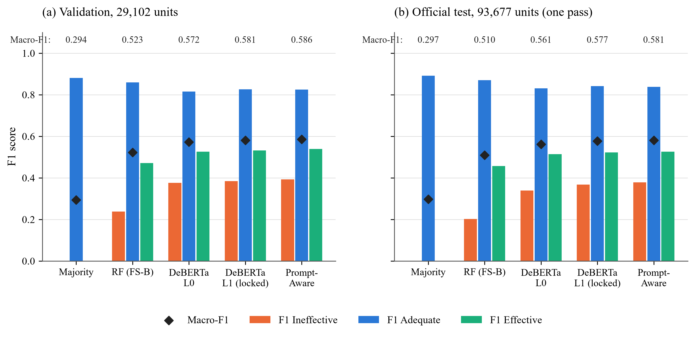

## Level 0 versus Level 1 on the same units (RQ2)

Level 1 differs from Level 0 only in its input: it adds the preceding and the following unit of the same essay (Section 4.3.3). Both models were trained on the same 115,187 units with the same configuration and seed, and both are evaluated on the same validation units and the same test units. Table 6.2 and Figure 6.2 give the per-class differences with paired essay-bootstrap intervals.

Table 6.2. Level 1 minus Level 0 on the same units (models scored on the test; 2,000 essay-bootstrap resamples).

| Metric | Validation (29,102 units) | Official test (93,677 units) |
|---|---|---|
| Macro-F1 | +0.0087 [+0.0015, +0.0161] | +0.0159 [+0.0115, +0.0205] |
| F1 Ineffective | +0.0091 [−0.0097, +0.0278] | +0.0292 [+0.0185, +0.0408] |
| F1 Adequate | +0.0108 [+0.0074, +0.0145] | +0.0098 [+0.0080, +0.0117] |
| F1 Effective | +0.0061 [−0.0017, +0.0136] | +0.0087 [+0.0040, +0.0135] |

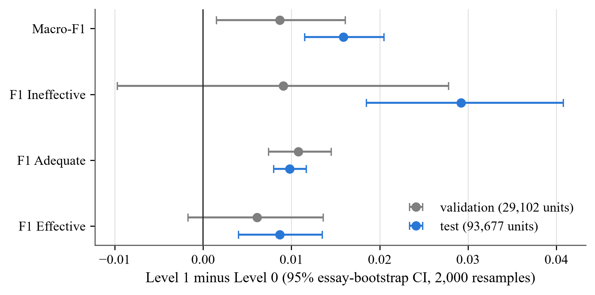

On the official test, Level 1 is better than Level 0 on every class, and the largest gain is on Ineffective (+0.029 F1). On validation the direction is the same but only the Macro-F1 and Adequate intervals exclude zero. A first training run of the same comparison gave +0.0022 Macro-F1 on validation with an interval containing zero ([−0.006, +0.011]), while its Ineffective F1 rose by +0.019. The two runs agree on direction but not on size, and the difference between them (0.0065) is of the same order as the effect (Section 6.7).

Table 6.3 shows what the extra context changes unit by unit. Context changes the predicted label of about 15% of units. Most changes move units between Adequate and Effective in both directions, and the gains only slightly outnumber the losses: on the test, 7,615 units become correct and 6,401 become wrong. For gold Ineffective units the balance is clearer: on the test, 519 are newly recognised and 335 are lost.

Table 6.3. Paired outcomes of Level 0 and Level 1 on the same units (table R4b).

| Outcome | Validation | Official test |
|---|---:|---:|
| Units | 29,102 | 93,677 |
| Same prediction | 24,490 | 79,453 |
| Prediction changed | 4,612 (15.8%) | 14,224 (15.2%) |
| Wrong under L0, correct under L1 | 2,452 | 7,615 |
| Correct under L0, wrong under L1 | 2,084 | 6,401 |
| Gold Ineffective newly recognised by L1 | 144 | 519 |
| Gold Ineffective recognised by L0 but missed by L1 | 118 | 335 |

Table 6.4 breaks the comparison down by discourse type. On the test, the gain is largest for the relational types whose definition refers to another unit: Counterclaim (+0.037 Macro-F1; Ineffective F1 0.201 → 0.281), Rebuttal (+0.028; 0.154 → 0.226) and Claim (+0.028; 0.237 → 0.292). It is smallest for Lead, Evidence and Position (+0.008). On validation, Position went the other way (−0.029), as it had in the first training run (Ineffective F1 −0.055). Validation subsets are small for rare types (34 Ineffective Rebuttals, 39 Ineffective Counterclaims), so per-type validation differences of this size can change sign between runs; the test subsets are about three times larger.

Table 6.4. Macro-F1 and Ineffective F1 of Level 0 and Level 1 by discourse type, same units (table R4a).

| Type | Val n (Ineff) | Val Macro-F1 L0 → L1 | Val Ineff F1 L0 → L1 | Test n (Ineff) | Test Macro-F1 L0 → L1 | Test Ineff F1 L0 → L1 |
|---|---|---|---|---|---|---|
| Lead | 1,902 (66) | 0.566 → 0.559 | 0.305 → 0.300 | 5,792 (304) | 0.583 → 0.590 | 0.322 → 0.344 |
| Position | 3,089 (100) | 0.559 → 0.530 | 0.358 → 0.279 | 10,250 (368) | 0.536 → 0.544 | 0.283 → 0.293 |
| Claim | 10,135 (317) | 0.509 → 0.528 | 0.280 → 0.302 | 32,375 (910) | 0.490 → 0.518 | 0.237 → 0.292 |
| Counterclaim | 1,148 (39) | 0.480 → 0.499 | 0.238 → 0.239 | 3,717 (114) | 0.476 → 0.513 | 0.201 → 0.281 |
| Rebuttal | 868 (34) | 0.513 → 0.515 | 0.326 → 0.292 | 2,880 (112) | 0.480 → 0.508 | 0.154 → 0.226 |
| Evidence | 9,249 (667) | 0.625 → 0.633 | 0.444 → 0.458 | 29,885 (1,956) | 0.615 → 0.622 | 0.401 → 0.419 |
| Concluding Statement | 2,711 (105) | 0.585 → 0.592 | 0.305 → 0.351 | 8,778 (461) | 0.597 → 0.609 | 0.355 → 0.391 |

The answer to the first part of RQ2 is therefore: neighbouring units add a small, consistent improvement, concentrated on the minority Ineffective class and on Claim, Counterclaim and Rebuttal units, whose quality is defined relative to an adjacent unit. The size of the improvement (about 0.01–0.02 Macro-F1) is comparable to run-to-run variation, so we do not state it more precisely than "small".

## Official test, one pass (RQ1)

Table 6.5 gives the results of the single scoring pass on the official test. The three protocol systems are the Random Forest (FS-B), DeBERTa L0 and the locked DeBERTa L1; Prompt-Aware and the linear SVM are labelled as extra systems.

Table 6.5. Official test results (93,677 units, 10,402 essays; one pass).

| System | Role | Macro-F1 | Accuracy | Balanced acc. | QWK | Ineffective P / R / F1 | Adequate F1 | Effective F1 |
|---|---|---:|---:|---:|---:|---|---:|---:|
| Majority (always Adequate) | floor | 0.297 | 80.5% | 33.3% | 0.000 | 0 / 0 / 0 | 0.892 | 0.000 |
| Random Forest, FS-B | protocol | 0.510 | 78.5% | 49.8% | 0.350 | 0.246 / 0.172 / 0.202 | 0.870 | 0.457 |
| DeBERTa-v3 L0 | protocol | 0.561 | 74.4% | 60.9% | 0.422 | 0.311 / 0.372 / 0.339 | 0.831 | 0.514 |
| DeBERTa-v3 L1 | protocol, locked | 0.577 | 75.7% | 62.2% | 0.442 | 0.330 / 0.415 / 0.368 | 0.841 | 0.523 |
| DeBERTa-v3 Prompt-Aware | exploratory | 0.581 | 75.4% | 63.4% | 0.446 | 0.331 / 0.442 / 0.379 | 0.838 | 0.526 |
| Linear SVM, TF-IDF ¹ | supplementary | 0.482 | 74.4% | — | — | — / — / 0.204 | 0.844 | 0.398 |

¹ Trained on training + validation units (144,289); the same configuration trained on the 115,187 training units scores 0.485 on validation. The first, mis-specified RF test run (0.483) is not shown; see Table 5.1.

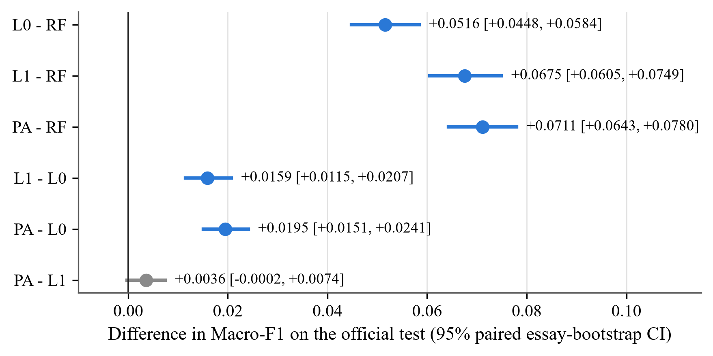

Validation and test agree closely (L1 0.581 vs 0.577; L0 0.572 vs 0.561; RF 0.526 vs 0.510 for the re-implemented FS-B), so no system was overfitted to validation in a way that collapsed on unseen essays. All three DeBERTa systems beat the Random Forest by 0.05–0.07 Macro-F1 with intervals far from zero (Figure 6.3); the gain comes from the minority classes (Ineffective F1 0.34–0.38 against 0.20; Effective F1 0.51–0.53 against 0.46), while the Random Forest keeps the highest accuracy and Adequate F1. Level 1 beats Level 0 (+0.016 [0.012, 0.021]). Prompt-Aware and Level 1 cannot be distinguished: the two-sided interval [−0.0002, +0.0074] contains zero, although the one-sided bootstrap proportion is 0.03; we base decisions on the two-sided interval.

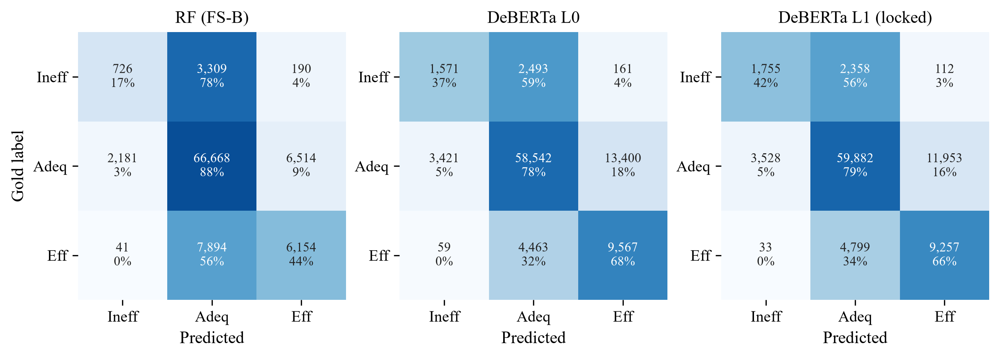

The confusion matrices (Figure 6.4) show the remaining problem. Even the locked system recognises only 41.5% of gold Ineffective units (1,755 of 4,225) and labels 2,358 of them Adequate; precision for Ineffective is 0.33, so two of every three Ineffective flags are wrong. Ineffective is almost never confused with Effective (112 and 33 units), which is consistent with an ordinal scale. Most errors lie between Adequate and Effective (11,953 + 4,799 units), the difficulty that dominates long essays (Section 7.2). Per discourse type, the locked system ranges from Macro-F1 0.508 (Rebuttal) to 0.622 (Evidence) on the test, and beats the Random Forest on every type (Appendix E, Table E.1).

## Prompt transfer: leave-one-prompt-out, kept separate from in-domain results (RQ3)

Figure 6.5 maps which prompts each system covers. In-domain systems (trained with all 15 prompts present) are evaluated over all prompts at once. LOPO systems are evaluated prompt by prompt: the Random Forest on all 15 prompts, the linear SVM and DeBERTa L0 on three. No LOPO number is averaged with, or placed in the same column as, an in-domain number.

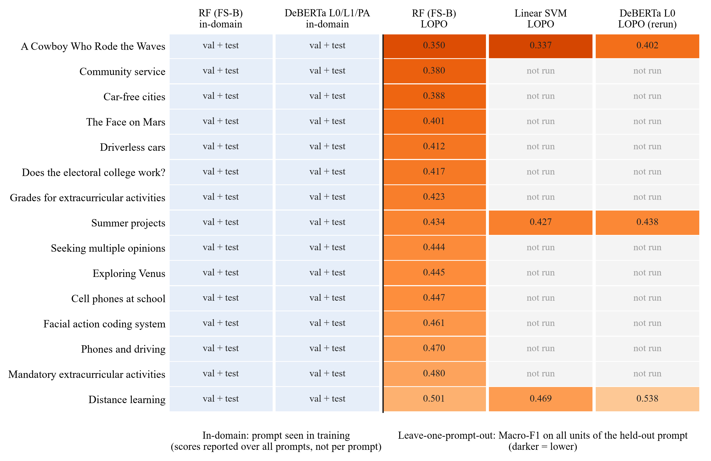

The Random Forest LOPO results (Figure 6.6) range from 0.350 ("A Cowboy Who Rode the Waves") to 0.501 ("Distance learning"), with a mean of 0.430 (standard deviation 0.041). Four of the five hardest prompts are source-based. These rankings selected the three prompts for the expensive DeBERTa folds.

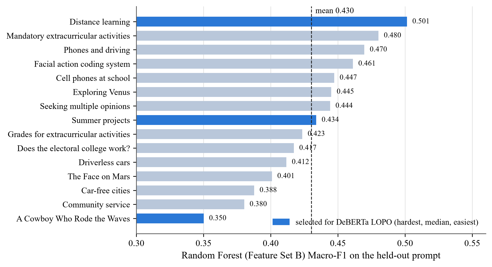

Table 6.6 compares the three families on the same LOPO folds, using all units of each held-out prompt. DeBERTa (fixed 3 epochs) scores highest on every prompt, but on "Summer projects" only narrowly (0.438 vs 0.434). Its Ineffective F1 stays low (0.11–0.24), and on "Summer projects", where only 0.9% of units are Ineffective, every family nearly fails on that class.

Table 6.6. Leave-one-prompt-out results on all units of the held-out prompt (Macro-F1 / Ineffective F1).

| Held-out prompt | Units / essays | Gold Ineff | Linear SVM | Random Forest | DeBERTa L0 |
|---|---|---:|---|---|---|
| A Cowboy Who Rode the Waves | 5,158 / 688 | 4.3% | 0.337 / 0.103 | 0.350 / 0.109 | 0.402 / 0.152 |
| Summer projects | 9,855 / 875 | 0.9% | 0.427 / 0.041 | 0.434 / 0.000 | 0.438 / 0.107 |
| Distance learning | 18,526 / 1,498 | 1.5% | 0.469 / 0.062 | 0.501 / 0.065 | 0.538 / 0.244 |

Table 6.6 compares families; it does not measure how much each family loses when a prompt is unseen, because the classical models have no in-domain score per prompt. Table 6.7 measures that loss for DeBERTa directly, on the same units: the validation essays of each held-out prompt, scored by the LOPO model and by the in-domain L0 model, which saw the prompt through other essays.

Table 6.7. DeBERTa L0, prompt unseen (LOPO) versus prompt seen (in-domain), on the same validation essays of the held-out prompt (gap with 2,000-resample essay-bootstrap CI; table R5).

| Held-out prompt | Units / essays | Setting | Macro-F1 | Ineff F1 | Adequate F1 | Effective F1 | Gap in Macro-F1 [95% CI] |
|---|---|---|---:|---:|---:|---:|---|
| A Cowboy Who Rode the Waves | 1,030 / 134 | in-domain | 0.476 | 0.235 | 0.882 | 0.309 | |
| | | LOPO | 0.384 | 0.135 | 0.777 | 0.240 | −0.092 [−0.132, −0.049] |
| Summer projects | 2,074 / 177 | in-domain | 0.508 | 0.231 | 0.714 | 0.578 | |
| | | LOPO | 0.483 | 0.250 | 0.639 | 0.560 | −0.025 [−0.052, +0.011] |
| Distance learning | 3,533 / 283 | in-domain | 0.576 | 0.275 | 0.800 | 0.652 | |
| | | LOPO | 0.528 | 0.210 | 0.754 | 0.620 | −0.048 [−0.078, −0.019] |

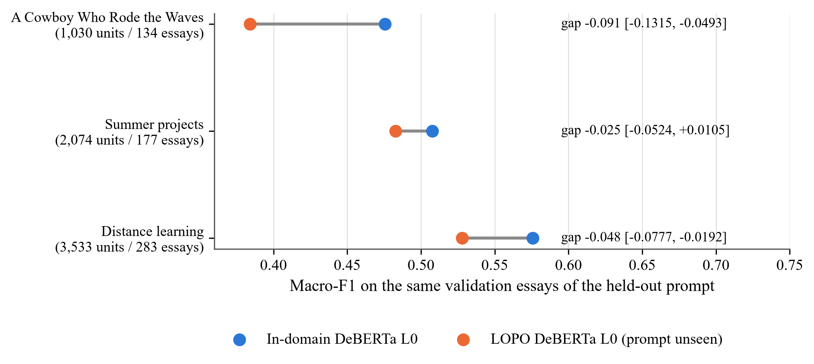

An unseen prompt costs DeBERTa Macro-F1 on two of the three prompts. The largest loss is on "A Cowboy Who Rode the Waves" (−0.092), a source-based narrative prompt whose essays refer to the people and events of one story; the loss is spread over all three classes. For "Summer projects" the interval includes zero, and its Ineffective F1 rests on 13 gold Ineffective units. With three prompts and one run per fold, the link between source-based prompts and larger losses is an interpretation, not a tested cause.

## Decision threshold for the Ineffective flag (sensitivity check)

The argmax rule is not the only way a teacher could use the model. A teacher who wants to see more of the weak units could flag every unit whose P(Ineffective) exceeds a threshold θ. Table 6.8 and Figure 6.8 show the trade-off for the locked L1 model on validation.

Table 6.8. Flagging units with P(Ineffective) ≥ θ, locked L1 model, validation (1,328 gold Ineffective units).

| Rule | Units flagged | Recall Ineff | Precision Ineff | F1 Ineff | Macro-F1 | Newly caught / new false alarms vs argmax | Ten cases flipped |
|---|---:|---:|---:|---:|---:|---|:---:|
| argmax | 1,761 | 44.7% | 33.7% | 0.385 | 0.581 | — | 0 |
| θ = 0.30 | 2,584 | 54.4% | 27.9% | 0.369 | 0.570 | 128 / 695 | 0 |
| θ = 0.20 | 3,253 | 60.0% | 24.5% | 0.348 | 0.558 | 203 / 1,289 | 0 |
| θ = 0.15 | 3,802 | 63.8% | 22.3% | 0.330 | 0.548 | 253 / 1,788 | 1 |
| θ = 0.10 | 4,633 | 69.6% | 19.9% | 0.310 | 0.535 | 330 / 2,542 | 3 |
| θ = 0.05 | 6,495 | 75.9% | 15.5% | 0.258 | 0.500 | 414 / 4,320 | 5 |

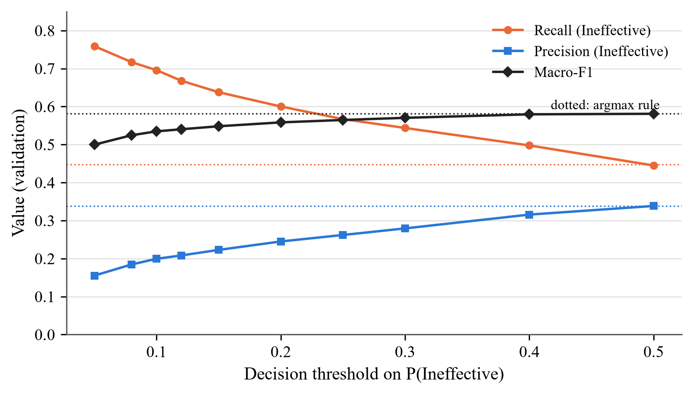

Lowering θ from argmax to 0.10 raises Ineffective recall from 45% to 70%, but every additional correct flag costs about eight false alarms, and Macro-F1 falls monotonically. A threshold does not make the classifier better; it moves the operating point along a fixed trade-off. Whether a teacher prefers to read 4,633 flagged units to see 70% of the weak ones, or 1,761 to see 45%, is a product decision for the user, which we did not make on the test. Case 8 (P(Ineffective) = 0.058 under this model) is flagged only when θ ≤ 0.058.

## Pre-defined subgroup: ELL status

Following Baffour et al. (2023), we describe the locked model separately for essays whose writers are recorded as English language learners. ELL status is never an input. Table 6.9 gives the results.

Table 6.9. Locked L1 model by recorded ELL status (table R9).

| Split | ELL status | Units / essays | Gold Ineff / Eff | Macro-F1 | Ineff P / R / F1 | Effective F1 |
|---|---|---|---|---:|---|---:|
| Validation | No | 25,308 / 2,685 | 4.0% / 17.8% | 0.573 | 0.320 / 0.422 / 0.364 | 0.535 |
| Validation | Yes | 2,246 / 268 | 12.2% / 4.8% | 0.561 | 0.403 / 0.553 / 0.466 | 0.357 |
| Test | No | 81,288 / 8,984 | 4.1% / 16.1% | 0.571 | 0.321 / 0.386 / 0.351 | 0.528 |
| Test | Yes | 7,577 / 914 | 10.5% / 4.7% | 0.543 | 0.364 / 0.554 / 0.439 | 0.319 |

The model recognises Ineffective units better in ELL essays (test recall 55% vs 39%) and Effective units worse (F1 0.32 vs 0.53). Both differences track the very different class mix of the two groups (10.5% vs 4.1% Ineffective; 4.7% vs 16.1% Effective), so they cannot be read as bias or its absence without conditioning on the label and proficiency. We report them as a description; a fairness audit would need the rater-level data and a pre-registered criterion, and we do not recommend any group-specific threshold.

## Stability and calibration

Two sources of uncertainty are not captured by the bootstrap intervals. The first is training randomness. The same L0 and L1 configurations trained twice gave validation Macro-F1 0.5768 and 0.5723 for L0 (−0.0045) and 0.5790 and 0.5809 for L1 (+0.0019), so the L1 − L0 gap moved from +0.0022 to +0.0087. Two supplementary configurations trained twice with the same seed differed by 0.0025 (L2) and 0.0039 (L1 ±2). Differences between DeBERTa variants below about 0.005–0.01 Macro-F1 should therefore not be interpreted as model differences. With one seed per configuration (GPU budget), we did not run the three seeds the course suggests; this is a limitation (Section 8.5).

The second is calibration. The class-weighted loss shifts probabilities towards the minority classes: the locked L1 model predicts Ineffective for 6.1% of validation units, against 4.6% gold. In an earlier check, temperature scaling fitted on 20% of validation (T = 1.124) did not improve the expected calibration error measured on the other 80% (0.0153 before, 0.0166 after), and that aggregate measure is dominated by the Adequate class. The probabilities are therefore used for ranking and thresholds, not as calibrated risks.

## Beyond Level 1: wider context (RQ2, supplementary, validation only)

After the official test pass we trained four further inputs with the Level 1 recipe (Table 4.2). They were never scored on the test and their epochs were chosen on validation, so they are explorations. Table 6.10 and Figure 6.9 give the results.

Table 6.10. Context ladder on validation (29,102 units). Δ vs L1 with paired essay-bootstrap CI (2,000 resamples).

| Input | Macro-F1 | Δ vs L1 [95% CI] | Ineff P / R / F1 | Effective F1 | Accuracy | Units flagged Ineffective |
|---|---:|---|---|---:|---:|---:|
| L0, unit only | 0.572 | −0.009 [−0.016, −0.001] | 0.335 / 0.428 / 0.376 | 0.526 | 72.9% | 5.8% |
| L1, ±1 unit (locked) | 0.581 | — | 0.337 / 0.447 / 0.385 | 0.532 | 74.2% | 6.1% |
| Prompt-Aware | 0.586 | +0.005 [−0.002, +0.011] | 0.328 / 0.488 / 0.393 | 0.539 | 74.1% | 6.8% |
| L1 ±2 units | 0.587 | +0.006 [−0.001, +0.013] | 0.332 / 0.498 / 0.398 | 0.536 | 74.1% | 6.8% |
| Paragraph | 0.569 | −0.012 [−0.020, −0.005] | 0.296 / 0.566 / 0.388 | 0.525 | 70.4% | 8.7% |
| L2, source passage | 0.579 | −0.002 [−0.010, +0.005] | 0.289 / 0.544 / 0.378 | 0.541 | 73.1% | 8.6% |
| L3, whole essay, 3 epochs | 0.576 | −0.005 [−0.014, +0.003] | 0.313 / 0.587 / 0.408 | 0.531 | 70.3% | 8.6% |
| L3, whole essay, 7 epochs | 0.570 | −0.011 [−0.020, −0.002] | 0.350 / 0.430 / 0.386 | 0.508 | 72.7% | 5.6% |

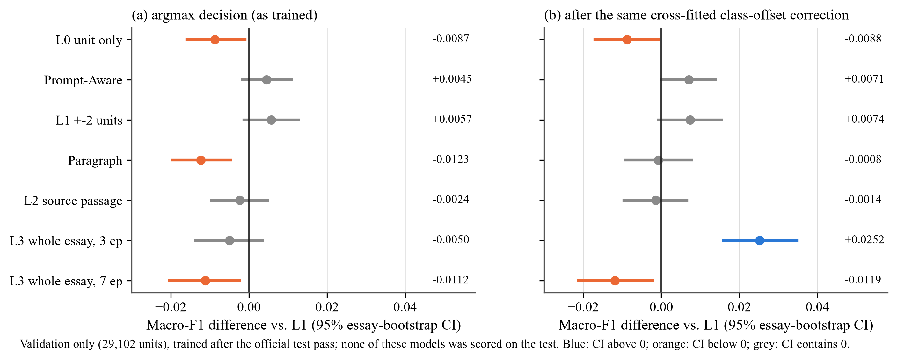

Under the argmax rule, no input beyond Level 1 is clearly better on Macro-F1. The wider inputs (paragraph, source passage, whole essay) shift the models towards Ineffective: recall rises to 54–59% and Ineffective F1 to 0.38–0.41, but precision and accuracy fall. Because every model was trained with the same class weights, argmax Macro-F1 mixes two properties: how well a model separates the classes and how its probabilities are shifted. To separate them we applied the same correction to every model: offsets added to the log-probabilities of Ineffective and Effective, chosen to maximise Macro-F1 on one half of the validation essays and applied to the other half, then swapped. After this correction (Figure 6.9b), the 3-epoch whole-essay model exceeds L1 by +0.025 [0.016, 0.035] (Macro-F1 0.619; Ineffective F1 0.434 vs 0.382), and an average of L1, L1 ±2 and L3 reaches 0.623. The paragraph and source inputs gain nothing.

This is the first result in the project that supports the hypothesis that whole-essay information helps to judge a unit, but three cautions apply: it is post-hoc and on validation, which also chose each model's epoch; it rests on one of the two L3 runs, the 7-epoch run having overfitted (training loss fell from 0.88 to 0.27 while validation Macro-F1 oscillated between 0.55 and 0.57); and no L3 model has been scored on the test. For Level 2, the 11 prompts without a source text received exactly the L1 input and serve as a control for run-to-run change: the difference-in-differences estimate of the source effect is −0.014 [−0.029, +0.002]. With crude retrieval, summaries instead of full texts for two prompts and no text for three, this shows that adding a retrieved passage this way did not help; it does not show that sources are irrelevant.

# Error Analysis

The error analysis proceeds in two steps: first check whether errors are associated with variables that also change the class mix (essay length, proficiency), and only then read individual cases and ask what information the model lacked. All analysis uses the validation split unless stated; test numbers are descriptive and no choice depends on them.

## Where the errors are

Under the locked L1 model, 25.8% of validation units and 24.3% of test units are misclassified. On the test (Figure 6.4), 74% of all errors are confusions between Adequate and Effective (16,752 of 22,783), 26% are confusions between Ineffective and Adequate (5,886), and fewer than 1% are Ineffective↔Effective (145). The errors that matter most to a teacher, missed Ineffective units, are 2,470 of the 4,225 gold Ineffective test units (58.5%).

## Errors and essay length: length or proficiency? (RQ4)

### The question

The error rate rises with essay length. Two explanations predict this. Hypothesis A: something about long essays makes their units harder to classify (longer units, more complex arguments, more truncation). Hypothesis B: long essays are written by stronger writers (Section 3.7.4); their units are more often Adequate or Effective, and the Adequate/Effective boundary is harder than the Adequate/Ineffective one. Hypothesis B is a change in the class mix, not a change in task difficulty, so it must be ruled in or out before any error is attributed to lost context.

### Without controlling for proficiency

Table 7.1 shows the L1 error rate by essay-length quartile. It rises from 22.0% to 30.5% on validation and from 21.1% to 30.4% on the test. Over the same quartiles the gold Ineffective share falls from 9.0% to 1.3% and the Effective share rises from 5.3% to 32.8%, and the share of errors that are Adequate↔Effective confusions rises from 48% to 92% (Figure 7.1a).

Table 7.1. Locked L1 errors by essay-length quartile (table R7).

| Quartile (words) | Val units / essays | Gold Ineff / Eff | Val error rate | Errors that are Adequate↔Effective | Val Macro-F1 | Val F1 Ineff / Adeq / Eff | Test error rate | Test Macro-F1 |
|---|---|---|---:|---:|---:|---|---:|---:|
| Q1 (≤315) | 7,333 / 1,037 | 9.0% / 5.3% | 22.0% | 47.5% | 0.532 | 0.430 / 0.868 / 0.298 | 21.1% | 0.532 |
| Q2 (316–422) | 7,277 / 786 | 5.0% / 10.7% | 23.0% | 67.1% | 0.551 | 0.366 / 0.858 / 0.427 | 22.0% | 0.530 |
| Q3 (423–566) | 7,226 / 690 | 2.9% / 18.3% | 27.9% | 83.8% | 0.552 | 0.365 / 0.812 / 0.480 | 25.5% | 0.548 |
| Q4 (≥567) | 7,266 / 606 | 1.3% / 32.8% | 30.5% | 92.0% | 0.526 | 0.192 / 0.743 / 0.642 | 30.4% | 0.566 |

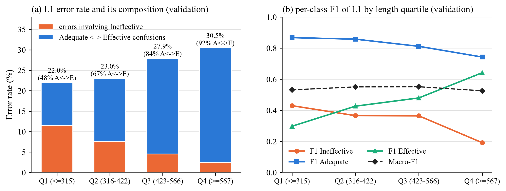

Figure 7.1b shows a pattern that a single error rate hides. Macro-F1 hardly changes across quartiles (0.53–0.55 on validation; 0.53–0.57 on test). What changes is which class is hard: Effective F1 rises from 0.30 to 0.64 as Effective units become common, while Ineffective F1 falls from 0.43 to 0.19 as they become rare. Much of the rising error rate is therefore the class mix moving towards the harder Adequate/Effective boundary, which supports Hypothesis B.

### Within the same holistic score

To separate length from proficiency we compare length quartiles within the same holistic score. Table 7.2 and Figure 7.2 show the result.

Table 7.2. L1 error rate (%) by length quartile within the same holistic score, validation. 95% CI from 1,000 essay-level bootstrap resamples; N = units / essays. Cells with fewer than 20 essays are shown in Appendix E only.

| Holistic score | Q1 (≤315) | Q2 (316–422) | Q3 (423–566) | Q4 (≥567) |
|:---:|---|---|---|---|
| 2 | 23.2 [21.3, 25.1]; 3,200/493 | 31.4 [27.1, 35.6]; 722/91 | 33.2 [26.3, 39.5]; 295/34 | — (80/11) |
| 3 | 19.3 [17.7, 21.1]; 3,517/424 | 21.8 [20.0, 23.9]; 3,743/404 | 22.9 [19.8, 26.0]; 1,465/143 | 28.2 [22.1, 34.3]; 472/40 |
| 4 | 19.6 [13.4, 26.6]; 260/29 | 22.0 [19.9, 23.9]; 2,622/260 | 28.5 [26.5, 30.5]; 3,984/379 | 31.1 [28.2, 33.9]; 1,961/174 |
| 5 | — | — (127/12) | 30.3 [26.9, 34.0]; 1,391/120 | 31.7 [29.6, 34.0]; 3,336/277 |

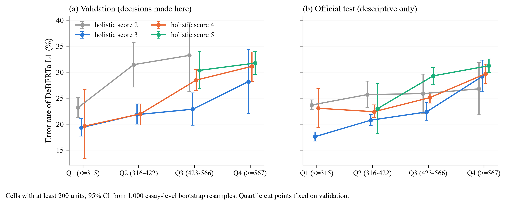

Within the same score, the error rate still rises with length. For score-3 essays it goes from 19.3% to 28.2% on validation (17.6% to 29.2% on the test); for score-4 essays from 19.6% to 31.1%. Table 7.3 summarises the trend with a logistic regression of unit error on length quartile (coded 0–3), with standard errors clustered by essay.

Table 7.3. Odds ratio of a unit error per length quartile, locked L1 model (essay-clustered 95% CI; `outputs/length_within_score_regression.csv`).

| Specification | Validation OR [95% CI] | Test OR [95% CI] |
|---|---|---|
| Length quartile only | 1.17 [1.14, 1.21] | 1.18 [1.16, 1.20] |
| + holistic score | 1.19 [1.14, 1.25] | 1.16 [1.13, 1.19] |
| + holistic score + gold label + discourse type | 1.17 [1.11, 1.23] | 1.13 [1.10, 1.16] |
| Score-3 essays only | 1.15 [1.06, 1.24] | 1.21 [1.16, 1.26] |
| Score-4 essays only | 1.27 [1.17, 1.37] | 1.17 [1.11, 1.23] |

Controlling for holistic score does not shrink the length effect, and controlling also for the gold label and discourse type shrinks it only slightly. The same pattern holds for DeBERTa L0 (OR 1.16 after controlling for score) and for the Random Forest (1.31).

### Answer

Both hypotheses are needed. Proficiency and class mix explain why the type of error changes with length and why Macro-F1 stays flat while the error rate rises (Hypothesis B). They do not explain the whole rise: within the same score and gold label, units of longer essays are still about 17% more likely per quartile to be misclassified, so Hypothesis A is not ruled out. We have not identified its mechanism. Truncation is an unlikely main cause, because only 0.62% of Level 1 inputs exceed 512 tokens. Plausible remaining explanations, none tested, are that units in long essays are longer and more elaborate, that raters judge a unit against the rest of a long, developed essay that a local model cannot see, and that the six-level holistic score leaves residual proficiency differences within each level.

## Ten high-confidence Ineffective failures

### Selection rule

Before any context model was trained, we selected the ten gold-Ineffective validation units that the DeBERTa L0 model misclassified with the highest confidence (probability of the predicted class above 0.94). The rule targets the failures that a teacher relying on the tool would never see. Because the cases were selected as extreme failures of one model, later models are expected to score them somewhat less extremely (regression to the mean); individual outcomes are illustrations, not estimates. Each case was read by the group together with the whole essay and, where relevant, the prompt and source.

Table 7.4. The ten cases: identifiers and P(Ineffective) under Level 0, the first Level 1 run and the locked Level 1 model (table R8). All ten have gold label Ineffective; every model predicts Adequate for all of them, except case 2, which is predicted Effective.

| Case | row_idx | essay_id_comp | Prompt | Type | Unit (start) | P(Ineff) L0 / L1 first / L1 locked |
|:---:|---:|---|---|---|---|---|
| 1 | 2467 | 6BF54A9F8383 | Phones and driving | Counterclaim | "There are many reason on why texting while driving is very useful" | 0.022 / 0.029 / 0.027 |
| 2 | 10303 | BFDD411D610F | Car-free cities | Evidence | "To provide reasonings to my strong point, brings me back to paragraph 36. …" | 0.000 / 0.001 / 0.008 |
| 3 | 25520 | 1CE967B8E5C9 | A Cowboy Who Rode the Waves | Position | "I think you shouldn't join the Seagoing Cowboys" | 0.022 / 0.010 / 0.006 |
| 4 | 105080 | 326DEFF8D486 | Cell phones at school | Counterclaim | "Not allowing students to use there phones at all" | 0.038 / 0.090 / 0.170 |
| 5 | 86267 | 8C10A8ABF46D | Driverless cars | Position | "The Driverless people can cause problems." | 0.028 / 0.151 / 0.103 |
| 6 | 114270 | C75B9C4FFEAD | Distance learning | Counterclaim | "But Sometimes it could be a distraction from you doing all your work." | 0.031 / 0.040 / 0.035 |
| 7 | 110025 | 53858BE44997 | Cell phones at school | Position | "I reconsider that are principal should let us eight graders bring are cell phones …" | 0.035 / 0.097 / 0.052 |
| 8 | 108613 | FE3141FA4163 | Cell phones at school | Claim | "Some kids will ask there parents to transfer school" | 0.021 / 0.124 / 0.058 |
| 9 | 83105 | 81B0FFE6659F | Driverless cars | Lead | "The future is near and the talk about driverless cars is upon us" | 0.045 / 0.080 / 0.143 |
| 10 | 9735 | 7D59699BB70F | Car-free cities | Claim | "Another cars is a bad idea is because of its gas." | 0.039 / 0.032 / 0.039 |

Table 7.5. Our reading of each case and the information a rater would need.

| Case | What we observed after reading the unit, the essay and (where relevant) the source | Information needed to judge it |
|:---:|---|---|
| 1 | A counterclaim ("texting while driving is very useful") that the essay never answers; read alone it is a fluent sentence | Whole essay |
| 2 | An accurate quotation of paragraph 36 of the source set (verified: the set has 43 paragraphs and paragraph 36 contains the quoted sentence), followed by off-topic reasoning about learner's permits and driving tests that does not support the point | The unit itself (the weakness is visible in it); the model was probably misled by length, an explicit quotation and connectives such as "Furthermore" (untested) |
| 3 | A bare stance with no reason (8 words) | The unit itself |
| 4 | A sentence fragment; no opposing argument is actually stated | The unit itself |
| 5 | A vague position that may conflict with the source article | Source and task |
| 6 | A counterclaim with no rebuttal anywhere in the essay | Whole essay |
| 7 | A thesis whose scope is unclear relative to the prompt | Prompt / task |
| 8 | An unsupported prediction; the neighbouring units do not supply a reason | Local context |
| 9 | A generic hook that does not engage the prompt | Prompt / task |
| 10 | A claim with no support and a garbled reason | The unit itself |

### Grouping and hypothesis check

The readings fall into four groups by the information a rater would need: the unit itself (cases 2, 3, 4, 10), local context (case 8), the whole essay (cases 1, 6) and the prompt or source (cases 5, 7, 9). This grouping led to a testable hypothesis on development data: if missing information causes these failures, giving the model that information should move the corresponding cases towards Ineffective. Figure 7.3 shows P(Ineffective) for every case under every context level.

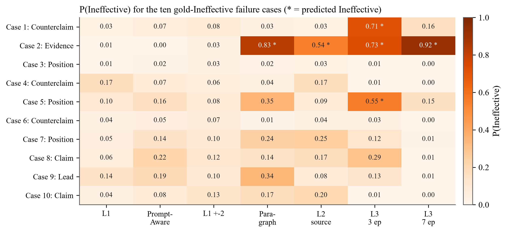

The result is mixed. Under Level 1, none of the ten cases changes its argmax prediction, although P(Ineffective) rose in 8 of 10 in the first L1 run. Wider inputs do move some cases: case 2 becomes Ineffective under the paragraph (P = 0.83), source-passage (0.54) and both whole-essay models (0.73 and 0.92); case 1, the unanswered counterclaim, becomes Ineffective only under the 3-epoch whole-essay model (0.71), and so does case 5 (0.55). Because the wider models flag more units overall, we checked whether these flips are only a shift of the threshold: lowering Level 1's threshold until it flags as many units as each wider model still flips none of the ten. The cases that need only the unit itself (3, 4, 10) are not repaired by any input, which points to a limit of the model or of the labels rather than of the context.

The hypothesis is therefore partly supported for the whole-essay group and not tested adequately for the source group (source texts were available for only 4 of 7 source-based prompts). Ten selected cases cannot establish an effect; the aggregate test is the post-hoc whole-essay result in Section 6.8, which is itself exploratory.

## Decisions changed by the error analysis

Table 7.6 records the decisions that the analyses in this chapter led to. Each row is traceable to a file in the repository.

Table 7.6. Decisions taken after inspecting errors.

| Question | Assumption before running | Output | Decision |
|---|---|---|---|
| Why are the most confident failures wrong? | Model weakness on short units | Most of the ten cases need information outside the unit | Design the controlled context ladder (L0 vs L1) |
| Does local context repair the cases? | Several cases would be repaired | 0 of 10 flip; Ineffective F1 rises slightly | Lock L1 for its Ineffective F1 while stating that L0 and L1 cannot be distinguished on validation |
| Is the rising error with length about difficulty? | Longer essays are more complex | Class mix shifts strongly with length | Compare errors within the same holistic score |
| Within the same score, does error rise with length? | No | Yes, OR ≈ 1.17–1.19 per quartile | Keep both hypotheses |
| Would a lower threshold catch the cases? | Case 8 flips at θ = 0.10 | Not for the locked model (P = 0.058); about 8 false alarms per extra catch | Keep argmax for evaluation; present θ as a user choice |
| Does wider context help? | Whole essay and sources should help | Argmax: no; after equal calibration correction: whole essay +0.025 (one run) | Report as exploratory; recommend a pre-registered test |

# Discussion

## What the results answer and what they do not

RQ1, model families. On the same units and metrics, the fine-tuned transformer is clearly better than the classical models and the trivial baseline on Macro-F1 and on both minority classes (official test: 0.577 vs 0.510 for the Random Forest and 0.297 for the majority baseline; Ineffective F1 0.368 vs 0.202). The classical models keep higher accuracy only because they predict the majority class more often. What the results do not show is that the transformer understands argument quality: it recognises fewer than half of the Ineffective units, and two of every three Ineffective flags are wrong.

RQ2, context. Adding the neighbouring units gives a small improvement that is consistent in direction across two training runs, the validation set and the test, and is largest for Ineffective units and for Claim, Counterclaim and Rebuttal. Its size is of the order of run-to-run variation, so the evidence supports "local context helps a little" and not a precise effect. Wider inputs did not improve Macro-F1 under the argmax rule; after an identical calibration correction for every model, one whole-essay run separated the classes better than Level 1 (+0.025). This is the strongest evidence in the project for the hypothesis that a unit's effectiveness depends on the whole essay, but it is post-hoc, validation-only and from one of two runs. The results do not answer whether source texts help, because the source material and retrieval were too limited.

RQ3, unseen prompts. A transformer that never saw the prompt lost 0.048 to 0.092 Macro-F1 on two of three prompts, measured on the same units as an in-domain model. The results do not say how large the loss is for the other twelve prompts, nor why the source-based "Cowboy" prompt lost most.

RQ4, errors. Essay length is strongly associated with proficiency and with the class mix, and that association explains why the kind of error changes with length and why Macro-F1 stays flat across length quartiles. Within the same holistic score and gold label, longer essays still have more errors. The analysis therefore supports both a class-mix explanation and a residual length effect, and it shows that neither should be reported as "lost context" without this check.

## Comparison with the sources read

Our findings agree with the corpus paper (Crossley et al., 2024) that Ineffective units are the hardest and are mostly predicted as Adequate: 2,358 of the 2,470 Ineffective units the locked model misses are labelled Adequate. They agree in direction with Ding et al. (2023), who found that the argument type, the prompt and the whole essay each raised QWK for BERT (0.42 → 0.46 with the prompt, 0.47 with the whole essay). Our corresponding validation QWK values are 0.433 for L0, 0.445 for L1, 0.455 for Prompt-Aware and 0.447 for the 3-epoch whole-essay model; the prompt effect is of similar size, but our whole-essay effect is smaller under the argmax rule. The settings differ: Ding et al. used a random split of the 4,192-essay Kaggle subset, BERT rather than DeBERTa-v3, and averaged folds; we used an essay-grouped split of the full corpus and paired intervals. Our post-hoc result, where the whole-essay model gained only after a calibration correction, suggests one reason why whole-essay context can look less useful than it is: wider inputs shift probabilities towards the minority classes, and an argmax evaluation penalises that shift.

Schaller et al. (2025) found that models relying on whole-essay context are fragile when context is limited. We saw a related fragility: the 7-epoch whole-essay model overfitted and lost the gain, and the paragraph input lowered Macro-F1. Baffour et al. (2023) reported moderate demographic differences in Feedback Prize effectiveness models; our ELL description shows large differences in per-class results that follow the class mix, which illustrates why such differences need careful conditioning before they are called bias.

## Model–rater agreement and rater–rater agreement answer different questions

A model's κ against the labels is easily mistaken for a rater's κ. Figure 8.1 places the two side by side only to show that they are different quantities.


Rater–rater κ (0.316 overall; 0.165–0.432 by type) answers the question: how consistently do two trained humans, working independently, assign the same label to the same segment? It describes the reliability of the measurement. It was computed by Crossley et al. on 159,228 segments where the two raters' segmentations overlapped by at least 50%, before a third rater adjudicated disagreements, with a weighted κ, on the whole corpus.

Model–rater κ (0.372 for the locked L1 model on the test; 0.27–0.44 by type) answers a different question: how well does the model reproduce the final adjudicated label, which is the label the model was trained to imitate? It is computed on our test units, with the gold segmentation, after adjudication, unweighted.

The two numbers differ in what is compared (two noisy humans vs a model and a consensus label), in the label (single ratings vs adjudicated), in the units (overlapping segments vs gold units), in the weighting, and in the data. A model κ above the rater κ therefore does not mean the model is "better than a rater" or "at human level". What the rater κ does tell us is that the label itself is uncertain: when two experts agree only at κ = 0.32, part of what we count as model error is disagreement about the label, and no model can be expected to reach a high agreement with any one rating. The per-type pattern is consistent with this (Claim and Counterclaim are the least reliable for raters and among the hardest for the model), but with seven types this is an observation, not a test.

## Implications for the intended user

For a teacher, the locked model is usable at most as a way to order the reading, not as a filter. Under the argmax rule it flags about 6% of units, of which one third are truly Ineffective, and it misses more than half of the Ineffective units. A teacher who lowers the threshold to see 70% of the weak units must read about 2.6 times as many flags (4,633 instead of 1,761 on validation), four of every five of them false alarms. The human must therefore read the essay before giving feedback, and the tool should never show a student a label that a teacher has not confirmed. Because performance drops on unseen prompts, a teacher using a new prompt should expect weaker rankings than those reported in Table 6.5. Demographic attributes must stay out of both the input and the decision rule.

## Limitations

1. Label reliability. Effectiveness labels have low inter-rater agreement (κ = 0.316). Our gold labels are adjudicated consensus labels, a proxy for effectiveness, not ground truth. Results are statements about agreement with these labels.
2. Gold segmentation and types. All models receive human-annotated units and types. A deployed system would have to segment essays itself, and its errors would lower performance (Ding et al., 2023).
3. One training run per configuration. Differences below about 0.005–0.01 Macro-F1 between DeBERTa variants are within observed run-to-run variation. The bootstrap intervals cover sampling of essays only.
4. Test-pass conditions. Training, validation and test ran in one session, so validation results were logged but not reviewed by a person before the test pass (Table 5.1).
5. LOPO coverage. DeBERTa and SVM LOPO cover 3 of 15 prompts with one run per fold; the Random Forest covers all 15.
6. Supplementary context runs. They were trained after the test pass, evaluated on validation only, which also chose their epochs, and the source passages covered 4 of 7 source-based prompts (two as summaries).
7. Length mechanism. The residual length effect is an association; its cause is untested.
8. Population. Results apply to U.S. grade 6–12 essays on 15 prompts. They do not establish effectiveness for other learners, languages or prompts, and they say nothing about learning outcomes.
9. Data integrity. The CSV files had been altered by a spreadsheet program before we received them. We verified the essay-level identifiers, labels and text against our predictions, but cannot rule out other silent changes in columns we did not use.

# Conclusion and Recommendations

## Conclusion

This project asked how well a model can predict the rater-assigned effectiveness of each discourse unit in a student essay, and what information it needs. Using PERSUADE 2.0 with an essay-grouped split and a single locked pass on the official test, we found that:

1. a fine-tuned DeBERTa-v3-base model clearly outperforms a majority baseline and classical models on Macro-F1 and on both minority classes (test Macro-F1 0.577 against 0.510 and 0.297), but still recognises fewer than half of the Ineffective units;
2. adding the neighbouring units to the input gives a small, consistent improvement, largest for Ineffective units and for Claim, Counterclaim and Rebuttal (test +0.016 Macro-F1, +0.029 Ineffective F1), of the same order as run-to-run variation;
3. wider inputs did not help under the argmax rule; a whole-essay model separated the classes better after an equal calibration correction (+0.025 on validation), which supports, but does not establish, the hypothesis that unit effectiveness depends on the whole essay;
4. an unseen prompt costs the transformer up to 0.09 Macro-F1 on the same units;
5. errors rise with essay length partly because the class mix changes with proficiency and partly for reasons that remain after controlling for the holistic score and gold label; length must be separated from proficiency before errors are blamed on missing context.

## Recommendations within scope

For the intended user: use the model only to order a teacher's reading of submitted essays on prompts similar to the training prompts, never as a grade or a filter; choose the threshold on P(Ineffective) according to how many units the teacher can review, knowing the false-alarm cost in Table 6.8; and keep demographic attributes out of inputs and decision rules.

For anyone extending the work: test the whole-essay model with a pre-registered protocol and at least three seeds on a fresh confirmation set; obtain the full source texts for all seven source-based prompts before testing source context again; run LOPO for all fifteen prompts with the transformer; and evaluate with predicted rather than gold segmentation.

## Future work

The most informative next experiment is the one our results point to but cannot settle: whether whole-essay information improves the separation of Ineffective units once calibration is held equal. A second direction is the residual length effect, which could be tested by controlling unit length and truncation directly. A third is label uncertainty: training with the individual raters' labels, if they can be obtained, would allow the model to represent disagreement instead of a single consensus label (Romberg et al., 2025).

# References {.unnumbered}

Baffour, P., Saxberg, T., & Crossley, S. A. (2023). Analyzing bias in large language model solutions for assisted writing feedback tools: Lessons from the Feedback Prize competition series. In Proceedings of the 18th Workshop on Innovative Use of NLP for Building Educational Applications (BEA 2023) (pp. 242–246). Association for Computational Linguistics.

Breiman, L. (2001). Random forests. Machine Learning, 45(1), 5–32.

Cohen, J. (1960). A coefficient of agreement for nominal scales. Educational and Psychological Measurement, 20(1), 37–46.

Crossley, S. A., Baffour, P., Tian, Y., Picou, A., Benner, M., & Boser, U. (2022). The persuasive essays for rating, selecting, and understanding argumentative and discourse elements (PERSUADE) corpus 1.0. Assessing Writing, 54, Article 100667.

Crossley, S. A., Tian, Y., Baffour, P., Franklin, A., Benner, M., & Boser, U. (2024). A large-scale corpus for assessing written argumentation: PERSUADE 2.0. Assessing Writing, 61, Article 100865. https://doi.org/10.1016/j.asw.2024.100865

Deshpande, D., Sourati, Z., Ilievski, F., & Morstatter, F. (2024). Contextualizing argument quality assessment with relevant knowledge. In Proceedings of the 2024 Conference of the North American Chapter of the Association for Computational Linguistics: Human Language Technologies (Volume 2: Short Papers) (pp. 316–326).

Devlin, J., Chang, M.-W., Lee, K., & Toutanova, K. (2019). BERT: Pre-training of deep bidirectional transformers for language understanding. In Proceedings of NAACL-HLT 2019 (pp. 4171–4186).

Ding, Y., Bexte, M., & Horbach, A. (2023). Score it all together: A multi-task learning study on automatic scoring of argumentative essays. In Findings of the Association for Computational Linguistics: ACL 2023 (pp. 13052–13063).

Efron, B., & Tibshirani, R. J. (1993). An introduction to the bootstrap. Chapman & Hall/CRC.

Favero, L., Pérez-Ortiz, J. A., Käser, T., & Oliver, N. (2025). Leveraging small LLMs for argument mining in education: Argument component identification, classification, and assessment. In Proceedings of the Workshop on Computational Models of Natural Argument (CMNA 2025).

Guo, C., Pleiss, G., Sun, Y., & Weinberger, K. Q. (2017). On calibration of modern neural networks. In Proceedings of the 34th International Conference on Machine Learning (ICML 2017) (pp. 1321–1330).

He, P., Gao, J., & Chen, W. (2023). DeBERTaV3: Improving DeBERTa using ELECTRA-style pre-training with gradient-disentangled embedding sharing. In International Conference on Learning Representations (ICLR 2023).

He, P., Liu, X., Gao, J., & Chen, W. (2021). DeBERTa: Decoding-enhanced BERT with disentangled attention. In International Conference on Learning Representations (ICLR 2021).

Liu, X., Feng, Y., & Chang, K.-W. (2024). CASA: Causality-driven argument sufficiency assessment. In Proceedings of the 2024 Conference of the North American Chapter of the Association for Computational Linguistics: Human Language Technologies (Volume 1: Long Papers) (pp. 5282–5302).

Newell, G. E., Beach, R., Smith, J., & VanDerHeide, J. (2011). Teaching and learning argumentative reading and writing: A review of research. Reading Research Quarterly, 46(3), 273–304.

Pedregosa, F., Varoquaux, G., Gramfort, A., Michel, V., Thirion, B., Grisel, O., et al. (2011). Scikit-learn: Machine learning in Python. Journal of Machine Learning Research, 12, 2825–2830. User guide sections "Common pitfalls and recommended practices" and "Cross-validation: evaluating estimator performance" (cross-validation iterators for grouped data), https://scikit-learn.org/stable/.

Romberg, J., Maurer, M., Wachsmuth, H., & Lapesa, G. (2025). Towards a perspectivist turn in argument quality assessment. In Proceedings of the 2025 Conference of the Nations of the Americas Chapter of the Association for Computational Linguistics: Human Language Technologies (Volume 1: Long Papers) (pp. 7458–7485).

Schaller, N.-J., Ding, Y., Jansen, T., & Horbach, A. (2025). Don't score too early! Evaluating argument mining models on incomplete essays. In Proceedings of the 20th Workshop on Innovative Use of NLP for Building Educational Applications (BEA 2025) (pp. 345–355).

Stab, C., & Gurevych, I. (2014). Identifying argumentative discourse structures in persuasive essays. In Proceedings of the 2014 Conference on Empirical Methods in Natural Language Processing (EMNLP) (pp. 46–56).

Stab, C., & Gurevych, I. (2017). Parsing argumentation structures in persuasive essays. Computational Linguistics, 43(3), 619–659.

Stahl, M., Michel, N., Kilsbach, S., Schmidtke, J., Rezat, S., & Wachsmuth, H. (2024). A school student essay corpus for analyzing interactions of argumentative structure and quality. In Proceedings of the 2024 Conference of the North American Chapter of the Association for Computational Linguistics: Human Language Technologies (Volume 1: Long Papers) (pp. 2661–2674).

Toulmin, S. E. (1958). The uses of argument. Cambridge University Press.

Wachsmuth, H., Lapesa, G., Cabrio, E., Lauscher, A., Park, J., Vecchi, E. M., Villata, S., & Ziegenbein, T. (2024). Argument quality assessment in the age of instruction-following large language models. In Proceedings of the 2024 Joint International Conference on Computational Linguistics, Language Resources and Evaluation (LREC-COLING 2024) (pp. 1519–1538).

Wachsmuth, H., Naderi, N., Hou, Y., Bilu, Y., Prabhakaran, V., Alberdingk Thijm, T., Hirst, G., & Stein, B. (2017). Computational argumentation quality assessment in natural language. In Proceedings of the 15th Conference of the European Chapter of the Association for Computational Linguistics (EACL 2017), Volume 1 (pp. 176–187).

# Appendix A. Run Table {.appendix}

Table A.1 lists every run behind a number in this report, with its split, configuration and output location.

Table A.1. Run table.

| Run | Model and input | Evaluated on (training data) | Configuration / seed | Main output | Status |
| --- | --- | --- | --- | --- | --- |
| R01 | BERT + DeBERTa ensemble | 14,303-unit development split; trained on the training part | — | `Ensemble_BERT_DeBERTa_A003/` | Dropped (gain CI contains 0) |
| R02 | LR, LR + thresholds, calibrated SVM, RF, LightGBM on FS-A / FS-B | 29,102 val; trained on 115,187 | Seed 42, sklearn 1.6.1 | `outputs/` | Used (RF FS-B = classical system) |
| R03 | DeBERTa-v3 L0 | 29,102 val; trained on 115,187 | Table 4.3 (fp16, RTX 4070 SUPER) | `person2_output/` | Used (DeBERTa vs RF on validation) |
| R04 | DeBERTa-v3 L0 and L1, first run | 29,102 val; trained on 115,187 | Table 4.3 | `week10_full_person2/`, `outputs/` | Used (run-to-run comparison, ten cases) |
| R05 | RF FS-B LOPO, 15 folds | Held-out prompt; trained on 14 prompts each | 150 trees, depth 35 | `outputs/` | Used |
| R06 | DeBERTa L0, L1, PA | 29,102 val; 93,677 test once; trained on 115,187 | Table 4.3, A100, bf16 | `Week11_Person3_…/` | Used (test pass, lock file) |
| R07 | RF FS-B | 29,102 val (gate 0.5261), then test once; trained on 115,187 | 200 trees, depth 35, sklearn 1.6.1 | `outputs/` | Used |
| R08 | Linear SVM, TF-IDF | Test; val 0.485; trained on 144,289 (115,187 for val) | — | `outputs/` | Supplementary |
| R09 | Linear SVM LOPO, 3 folds | Held-out prompt; trained on 14 prompts | — | `outputs/` | Supplementary |
| R10 | DeBERTa L0 LOPO, 3 folds | Held-out prompt, once; trained on 14 prompts | Fixed 3 epochs, final model, transformers 4.57.6, L4 | `week11_lopo_rerun/` | Used |
| R11 | L1 ±2 (2 runs), paragraph, L2 (2 runs), L3 3 ep, L3 7 ep | 29,102 val only; trained on 115,187 | L1 recipe, L4, bf16 | `week11_context_levels/`, `outputs/` | Exploratory |
| R12 | Post-hoc class-offset correction and ensembles | Val, 2-fold cross-fitting by essay | Grid −2.0 … +1.5 | `outputs/` | Exploratory |
| R13 | LR FS-B (interpretable reference) | 29,102 val; trained on 115,187 | C = 1, balanced, sklearn 1.9 | `final_report/` | Used (Tables 4.1, 6.1) |

# Appendix B. Reproducibility and Execution Instructions {.appendix}

## B.1 Data

1. Download the PERSUADE 2.0 training and test CSV files from the links in the corpus repository (github.com/scrosseye/persuade_corpus_2.0; the test archive password is given in its README).
2. Place them at `data/persuade_raw/persuade_corpus_2.0_train.csv` and `data/persuade_raw/persuade_corpus_2.0_test.csv`. Do not open and re-save them in a spreadsheet program.
3. The files used in this report have SHA-256 `f61319edd8bf16a982711ea0399fad59c05afaec05cdf0767f16a2c05c467e23` (train) and `8b4cbbda471b313e5d11da10d4fc2659defa1a8f710639e98d011e1c7141d3a6` (test). Script 01 checks both hashes. A freshly downloaded file may differ in its numeric ID columns (ours were altered by a spreadsheet program); `essay_id_comp`, texts and labels are what matter, and script 01 checks them.

## B.2 Environments

Table B.1. Software environments.

| Purpose | Environment |
|---|---|
| Final-report scripts (data checks, tables, figures, LR reference) | Python 3.14, pandas 3.0, NumPy, SciPy, statsmodels 0.15, scikit-learn 1.9, matplotlib 3.11; CPU only |
| Classical models (RF FS-B) | Python 3.10, scikit-learn 1.6.1 (the RF result is reproduced exactly only with this version) |
| DeBERTa | Google Colab, Python 3.13, PyTorch 2.11 + CUDA 13, transformers 4.57.6 (not 5.x), bf16; A100 for R06, L4 for R10–R11 |
| Diagrams | Mermaid CLI with the configuration in `final_report/diagrams/` |

## B.3 Commands that rebuild the report's numbers and figures

From the repository root, without a GPU (about three minutes):

```
python final_report/scripts/01_data_checks_eda.py        # checks C1-C7, EDA tables D*, E*
python final_report/scripts/02_results_from_predictions.py  # tables R1-R7 from saved predictions
python final_report/scripts/03_ten_cases.py              # table R8 (ten cases with IDs)
python final_report/scripts/05_lr_interpretable_reference.py # LR reference, tables L1-L3
python final_report/scripts/06_subgroup_ell.py           # table R9
python final_report/scripts/07_export_split_ids.py       # clean split files keyed by essay_id_comp / row_idx
python final_report/scripts/04_figures.py                # all data figures
```

To retrain models (GPU): `Week11_Person3_DeBERTa_OfficialTest/07_person3_prompt_aware_official_test.ipynb` (L0, L1, PA and the test pass; it refuses to score the test twice), `week11_lopo_rerun/11_lopo_rerun_L0.ipynb` (LOPO), `week11_context_levels/*.ipynb` (context ladder), `Person1/run_rf_official_test.py` (RF FS-B with the validation gate), `Person1/script_holistic_length_table.py` (length × score tables and regression), `script_threshold_tuning_and_case8.py` (threshold table), `script_lopo_same_units_gap.py --rerun` (same-unit LOPO gaps). Every notebook is saved with its outputs.

## B.4 Seeds, splits and identifiers

All splits and models use seed 42; the random raw-record sample in Table 3.5 uses seed 2026. The train/validation assignment is defined by the `row_idx` values in `val_predictions_L1.csv` (validation) and their complement (training); `final_report/tables/split_essays.csv` (one row per essay, keyed by `essay_id_comp`) and `final_report/tables/split_units.csv.gz` (one row per unit, keyed by `row_idx`) store the assignment for all three sets; they are produced and checked by `final_report/scripts/07_export_split_ids.py`. The older `outputs/split_assignments.csv` is keyed by the spreadsheet-rounded `essay_id` and should not be used for joins. Every prediction file stores `row_idx`, `essay_id_comp`, discourse type, gold label, predicted label and the three probabilities. Never join on `discourse_id`.

## B.5 Files behind the main tables

Table B.2. Where each main result comes from.

| Report element | Source file(s) |
|---|---|
| Table 3.4–3.5, data checks | `final_report/evidence/data_checks_log.txt`, `tables/D*.csv` |
| Table 6.1 | `tables/R1_validation_per_class.csv`, `tables/L1_lr_validation.csv` |
| Tables 6.2–6.4 | `tables/R4a`, `R4b`, `R4c` |
| Table 6.5, Figure 6.3 | `tables/R2_test_per_class.csv`, `Week11_…/outputs/official_test_deberta_bootstrap.csv`, `outputs/official_test_bootstrap_deberta_vs_rf.csv` |
| Tables 6.6–6.7 | `outputs/lopo_*`, `tables/R5_lopo_vs_indomain_per_class.csv` |
| Table 6.8 | `outputs/ineffective_threshold_tuning_table.csv` |
| Table 6.10 | `outputs/context_levels_validation_summary.csv`, `context_levels_posthoc_bias_ensemble.csv` |
| Tables 7.1–7.3 | `tables/R7`, `outputs/holistic_score_x_length_quartile_error_rates.csv`, `outputs/length_within_score_regression.csv` |
| Tables 7.4–7.5 | `tables/R8_ten_cases.csv` |

## B.6 Data that are not shared

The PERSUADE CSV files (licence and size) and the source articles used for Level 2 (copyright) are excluded from the repository by `.gitignore`. Model checkpoints (about 2.2 GB) are not shared; all predictions behind the tables are.

# Appendix C. Individual Contributions {.appendix}

Roles were assigned per week in the planning files `HUONG_DAN_PHAN_CONG_TUAN_9.md`, `WEEK10_PLAN_AND_ASSIGNMENTS.md` and `WEEK11_PLAN_AND_ASSIGNMENTS.md` as Member 1 (data and classical models), Member 2 (transformer and context) and Member 3 (error analysis, LOPO and test governance). The person holding a role changed between weeks; the names below are filled in by the group from its own records. Table C.1 lists the work and the evidence; detailed decision logs per role, written in the course's format (date, question, assumption before the run, output, change), are kept in the repository.

Table C.1. Contributions by role and week.

| Week | Role 1 | Role 2 | Role 3 |
|---|---|---|---|
| Name | [name for Wk 9] / [name for Wk 10–11] | [name] | [name for Wk 9] / [name for Wk 10–11] |
| Before Wk 9 | (member who later held Role 1 in Week 9) Literature search (papers R01–R03), dataset selection, prototype pipeline (`discourse_effectiveness_pipeline.py`), BERT + DeBERTa ensemble run A003 (`Ensemble_BERT_DeBERTa_A003/`) | [to be completed by the group] | [to be completed by the group] |
| Wk 9 | Data pipeline, essay-grouped split (115,187 / 29,102), classical baselines on FS-A/FS-B, label-mapping check for LR (`01_Data_Pipeline_Classical_Baseline.*`, `week9_person1_outputs/`) | Single DeBERTa vs RF on the same units with essay bootstrap, calibration check, decision to drop the ensemble (`person2_output/`) | Ten failure cases, errors by type and prompt, ELL audit, literature mapping (`outputs/10_ineffective_case_studies.md`, `error_breakdown_*.csv`) |
| Wk 10 | Label × prompt × length tables; RF LOPO for 15 prompts (`week10_output_person1/`) | Controlled L0 vs L1 ablation; re-check of the ten cases (`week10_full_person2/`) | DeBERTa LOPO on 3 prompts; Week 10 report (`week10_person3_full/`) |
| Wk 11 | Holistic score × length table and regression; RF FS-B test with validation gate (`Person1/`) | Threshold analysis and case counting; linear SVM on test and LOPO (`Person2Khoa/`, `script_threshold_tuning_and_case8.py`) | Retraining of L0/L1/PA, locked test pass, bootstrap (`Week11_Person3_…/`); audit of code and report (`RA_SOAT_…md`); LOPO rerun; context ladder (`week11_lopo_rerun/`, `week11_context_levels/`) |
| Final report | [to be completed by the group] | [to be completed by the group] | Data verification scripts, recomputed tables and figures, report text (`final_report/`) |

Decisions that each role can show evidence for are recorded in Table 7.6 and in the repository.

# Appendix D. Use of AI Tools {.appendix}

AI assistants were used while preparing the project. None is part of the studied pipeline: no model output in this report was produced by prompting a language model. Table D.1 lists the uses we know of; members complete it for their own work.

Table D.1. AI assistance and how it was checked.

| Tool | Used for | How the output was checked |
|---|---|---|
| Claude Code (Anthropic) | Running Colab GPU jobs through a command-line client; generating and debugging notebooks for the GPU runs; an audit of code and report; data-verification and figure scripts and drafting of this final report | Every number recomputed from raw data or saved predictions by scripts in the repository; assertions on row alignment and labels; the audit's findings were checked against the code and data before any change; report text checked against the tables |
| OpenAI Codex (command-line agent) | Regenerating notebooks from corrected scripts; building the Word and PDF versions of reports | Notebooks re-executed; generated documents compared with the Markdown source |
| Gemini / Antigravity IDE | Coding assistance and drafting | [members to describe] |
| [other tools used by members] | [ ] | [ ] |

Where the AI-assisted audit pointed to a problem in code or data, the group verified it by rerunning code on the data before changing anything. Explanations that AI tools suggested but that could not be verified against data were not used. AI detectors were not used.

# Appendix E. Supplementary Tables {.appendix}

Table E.1. Official test results by discourse type: locked L1 and Random Forest (table R6).

| Type | Units | Gold Ineff | L1 Macro-F1 | L1 F1 Ineff / Adeq / Eff | RF Macro-F1 | RF F1 Ineff |
|---|---:|---:|---:|---|---:|---:|
| Lead | 5,792 | 304 | 0.590 | 0.344 / 0.811 / 0.614 | 0.516 | 0.140 |
| Position | 10,250 | 368 | 0.544 | 0.293 / 0.889 / 0.450 | 0.400 | 0.129 |
| Claim | 32,375 | 910 | 0.518 | 0.292 / 0.836 / 0.427 | 0.409 | 0.068 |
| Counterclaim | 3,717 | 114 | 0.513 | 0.281 / 0.849 / 0.409 | 0.424 | 0.100 |
| Rebuttal | 2,880 | 112 | 0.508 | 0.226 / 0.816 / 0.482 | 0.480 | 0.173 |
| Evidence | 29,885 | 1,956 | 0.622 | 0.419 / 0.836 / 0.612 | 0.542 | 0.251 |
| Concluding Statement | 8,778 | 461 | 0.609 | 0.391 / 0.837 / 0.597 | 0.551 | 0.258 |

Table E.2. L1 error rate (%) by holistic score and length quartile, all cells, validation and official test (essay-bootstrap 95% CI; N = units / essays).

| Score | Split | Q1 (≤315) | Q2 (316–422) | Q3 (423–566) | Q4 (≥567) |
|:---:|---|---|---|---|---|
| 1 | Val | 39.6 [32.6, 45.6]; 356/91 | 22.2 [12.9, 32.7]; 63/19 | 33.8 [15.8, 51.1]; 74/13 | 34.8 [16.7, 64.3]; 23/4 |
| 1 | Test | 32.0 [28.7, 35.2]; 1,065/311 | 29.3 [21.7, 37.1]; 239/65 | 31.7 [20.6, 44.1]; 101/26 | 26.3 [9.8, 42.9]; 57/16 |
| 2 | Val | 23.2 [21.3, 25.1]; 3,200/493 | 31.4 [27.1, 35.6]; 722/91 | 33.2 [26.3, 39.5]; 295/34 | 38.8 [27.9, 51.0]; 80/11 |
| 2 | Test | 23.7 [22.8, 24.7]; 13,060/2,054 | 25.7 [23.2, 28.3]; 2,141/279 | 25.9 [22.1, 29.6]; 858/98 | 26.8 [21.8, 31.8]; 418/50 |
| 3 | Val | 19.3 [17.7, 21.1]; 3,517/424 | 21.8 [20.0, 23.9]; 3,743/404 | 22.9 [19.8, 26.0]; 1,465/143 | 28.2 [22.1, 34.3]; 472/40 |
| 3 | Test | 17.6 [16.8, 18.5]; 13,684/1,662 | 20.8 [19.7, 21.9]; 10,596/1,150 | 22.3 [20.8, 24.1]; 4,597/459 | 29.2 [26.2, 32.3]; 1,618/154 |
| 4 | Val | 19.6 [13.4, 26.6]; 260/29 | 22.0 [19.9, 23.9]; 2,622/260 | 28.5 [26.5, 30.5]; 3,984/379 | 31.1 [28.2, 33.9]; 1,961/174 |
| 4 | Test | 23.1 [19.4, 26.8]; 1,267/139 | 22.4 [21.3, 23.7]; 9,131/910 | 25.1 [24.0, 26.2]; 11,755/1,101 | 29.7 [27.8, 31.5]; 4,404/387 |
| 5 | Val | — | 29.1 [21.3, 38.0]; 127/12 | 30.3 [26.9, 34.0]; 1,391/120 | 31.7 [29.6, 34.0]; 3,336/277 |
| 5 | Test | — | 23.0 [18.2, 27.8]; 418/37 | 29.3 [27.6, 31.0]; 4,836/430 | 31.2 [29.9, 32.5]; 9,012/748 |
| 6 | Val | — | — | 23.5 (n.a.); 17/1 | 26.8 [24.2, 29.7]; 1,394/100 |
| 6 | Test | — | — | 25.2 [14.2, 36.3]; 123/11 | 30.1 [28.0, 32.1]; 4,297/315 |

Table E.3. Prediction transitions from Level 0 (rows) to Level 1 (columns), same units.

| Split | L0 prediction | L1 Ineffective | L1 Adequate | L1 Effective |
|---|---|---:|---:|---:|
| Validation | Ineffective | 1,057 | 630 | 10 |
| Validation | Adequate | 697 | 17,489 | 1,294 |
| Validation | Effective | 7 | 1,974 | 5,944 |
| Test | Ineffective | 3,024 | 2,016 | 11 |
| Test | Adequate | 2,276 | 59,170 | 4,052 |
| Test | Effective | 16 | 5,853 | 17,259 |

Table E.4. Logistic Regression (FS-B) features with the largest weight for each class relative to the class average (table L2).

| Class | Top features (weight) |
|---|---|
| Ineffective | witch (+3.22), plant (+3.13), on whether (+3.10), aliens (+2.97), positive and (+2.86), on that (+2.82), story (+2.68), discussing (+2.65), venus (+2.62) |
| Adequate | many advantages (+1.91), driving (+1.89), selves (+1.81), forget (+1.80), play sport (+1.78), mesa (+1.68), phones (+1.65), mission (+1.64) |
| Effective | of (+3.88), trash (+3.80), and (+3.27), students (+2.66), to (+2.61), does not (+2.49), community (+2.40), exploration (+2.39), safety (+2.35) |

# Appendix F. Alignment with the Assessment Criteria {.appendix}

Table F.1. Where each criterion of the report rubric is addressed.

| Criterion (points) | What the rubric asks | Where in this report |
|---|---|---|
| Question and scope (4) | User, decision, input/output, prediction time; measurable question; population limits | §1.2 (Table 1.1), §1.3, §8.5 item 8 |
| Understanding the data (8) | Source and use conditions, row unit and groups, labels, distributions, missingness, duplicates, sample trace, measurement limits | §3.1–3.8, Tables 3.1–3.7 |
| Methods and model selection (8) | Baseline, two families, features, loss, assumptions, selection, preprocessing fitted on training data | §4.1–4.4, §5.2 |
| Experiments and comparisons (6) | Same data, budget and metrics; configurations saved; controlled check; stability | §5.7, §6.1–6.3, §6.7, App. A |
| Error analysis and original work (6) | ≥ 10 cases by a stated rule; grouped errors; hypothesis tested on development data; decisions recorded | §7.2–7.4, Tables 7.4–7.6 |
| Reproducibility and evidence (4) | Commands, versions, seeds, splits, IDs, predictions, environment; contributions | App. B, App. C |
| Report quality and responsible use (4) | Problem → question → method → data → result → interpretation; sources support claims; limitations, permissions and AI use | Chapters 1–9, §3.1, §8.5, App. D |
